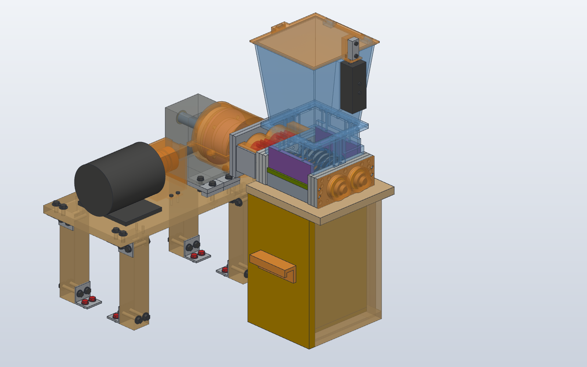

# plastic-shredder

A small twin-shaft shredder for 3D-print waste.

- **Made from shop stock** (blades, plates, sleeves, pillars) on a manual lathe (Roher TBL-20/520), a manual mill (SIEG X3.5D) and a small CNC router (Jingyan CNC4030).
- **Bought parts:** all from Amazon, among them six needle bearings, the timing gears (m4 z15, hardened teeth), a worm gearbox, a jaw coupling, a TL350 torque limiter on shaft A, 4 dowel pins and the shaft steel. Each gear sits between two bearings: an outboard bearing plate (100x10 flat, bought locally) carries the third bearing of each shaft.
- **Drive:** a salvaged 375 W single-phase motor, coupled straight to the worm gearbox; the gearbox's output is on shaft A's axis and drives the torque limiter through a pin flange (no belt, no chain).
- **Output:** a fixed aluminium screen 2 mm under the blades (Ø5 holes). What passes falls into the drawer; the rest is carried round and cut again. The screen is also the guard from below.

- **Start here:** [docs/DESIGN.md](docs/DESIGN.md). It covers the parts lists with Amazon links, how to make each part, the drive and torque limiter, assembly and safety.
- **Strength, drive and machining checks:** [docs/CALCULATIONS.md](docs/CALCULATIONS.md). This file is generated.
- **Every dimension:** [design/params.py](design/params.py).
- **The CAD model:** [cad/shredder_assembly.sc](cad/shredder_assembly.sc), a [SolidCraft](https://github.com/tangency-labs/solidcraft) design with every part as a body, joints and motion studies. [cad/solidcraft](cad/solidcraft/README.md) builds it from the parameters. The parts are in `cad/step`, `cad/stl` and `cad/dxf`.

`make all` regenerates the parameters, the calculations, the SolidCraft model and the STEP, STL and DXF files of the parts, and runs the design checks. `make variants` re-checks the fit for other sizes of the bought parts (gear hubs, the limiter's sprocket position, gearbox, motor shaft, the pin flange's gap). Needs Python 3 (no extra packages) and SolidCraft 0.40 with `solidcraft-cli` on `PATH`. The design checks and `make variants` still run on the OpenSCAD sources in `cad/` and need OpenSCAD.

`.mcp.json` registers SolidCraft's MCP server for Claude Code (`solidcraft-cli mcp --allow-path .`), so an agent started in this folder can open, measure and change the model.
