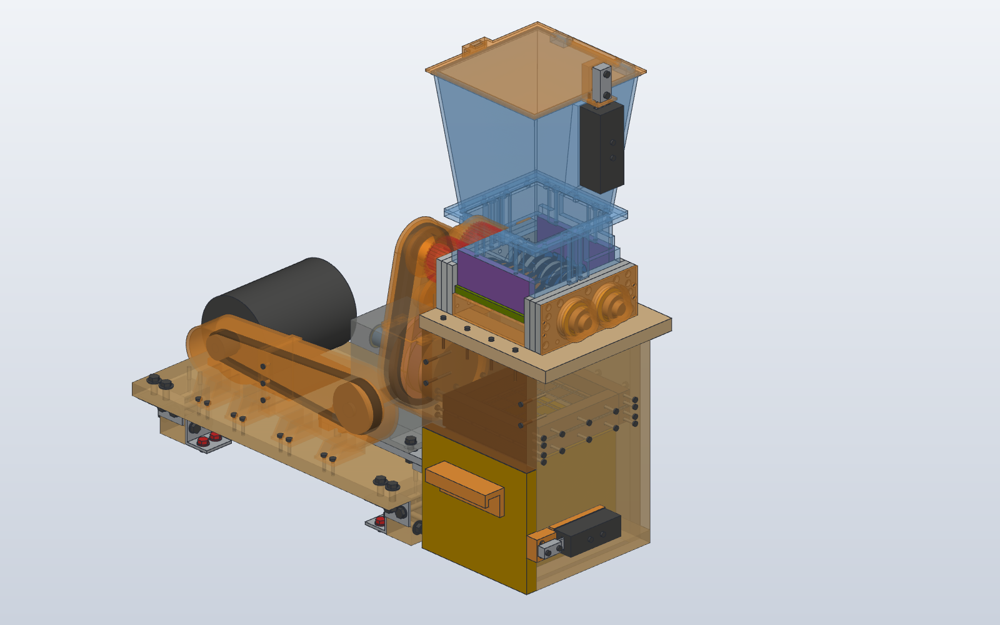

# plastic-shredder

A small twin-shaft shredder for 3D-print waste.

- **Made from shop stock** (blades, plates, sleeves and the laminated, case-hardened timing gears cut with your module 1.5 cutter set) on a manual lathe (Roher TBL-20/520), a manual mill (SIEG X3.5D) and a small CNC router (Jingyan CNC4030).
- **Bought parts:** all from Amazon, among them needle bearings, a worm gearbox, a TL350 torque limiter, the chain drive and the shaft steel. The gears are made in the shop (module 1.5, z 40, 4 layers of the 70x10 flat, case-hardened; one extra 600 mm piece of flat is needed).
- **Drive:** a salvaged 375 W single-phase motor.

- **Start here:** [docs/DESIGN.md](docs/DESIGN.md). It covers the parts lists with Amazon links, how to make each part, the drive and torque limiter, assembly and safety.
- **Strength, drive and machining checks:** [docs/CALCULATIONS.md](docs/CALCULATIONS.md). This file is generated.
- **Every dimension:** [design/params.py](design/params.py).
- **The CAD model:** [cad/shredder_assembly.sc](cad/shredder_assembly.sc), a [SolidCraft](https://github.com/tangency-labs/solidcraft) design with every part as a body, joints and motion studies. [cad/solidcraft](cad/solidcraft/README.md) builds it from the parameters. The parts are in `cad/step`, `cad/stl` and `cad/dxf`.

`make all` regenerates the parameters, the calculations, the SolidCraft model and the STEP, STL and DXF files of the parts, and runs the design checks. `make variants` re-checks the fit for other sizes of the bought parts and for other gear layer thicknesses. Needs Python 3 (no extra packages) and SolidCraft 0.40 with `solidcraft-cli` on `PATH`. The design checks and `make variants` still run on the OpenSCAD sources in `cad/` and need OpenSCAD.

`.mcp.json` registers SolidCraft's MCP server for Claude Code (`solidcraft-cli mcp --allow-path .`), so an agent started in this folder can open, measure and change the model.
