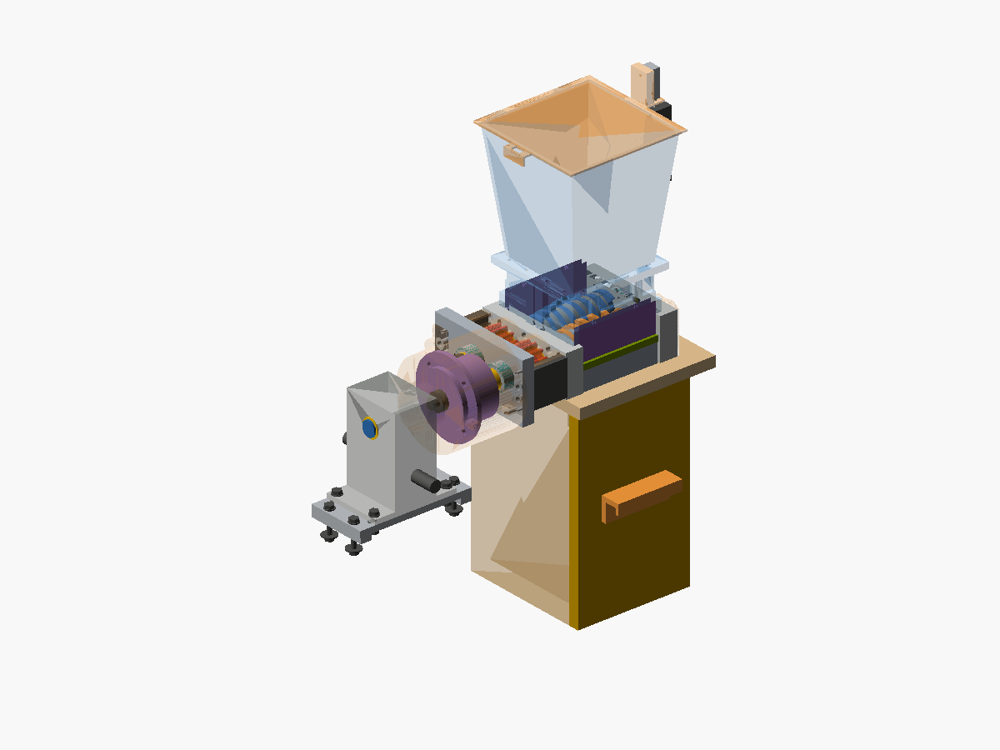
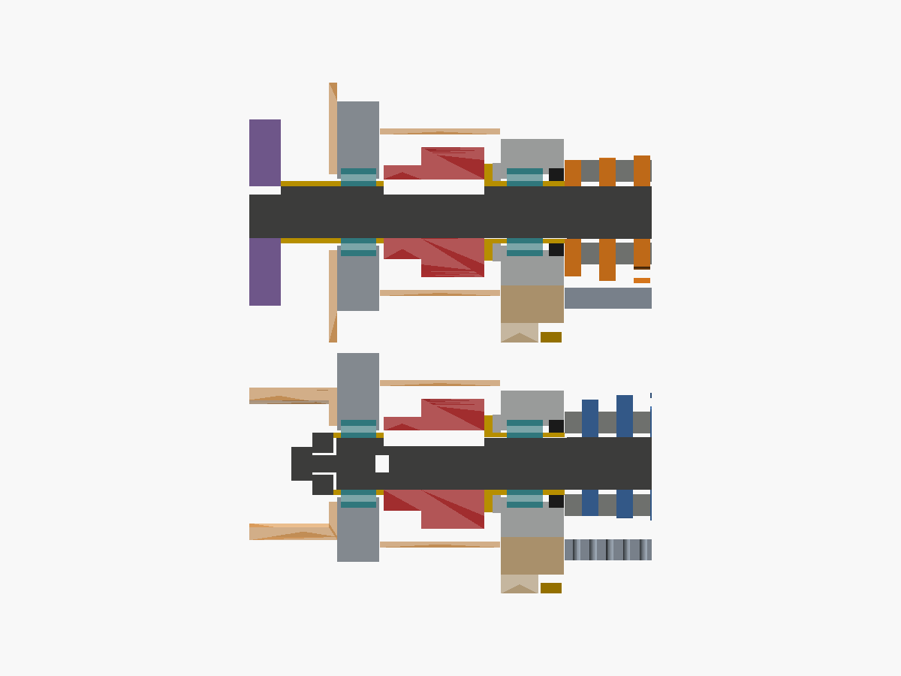
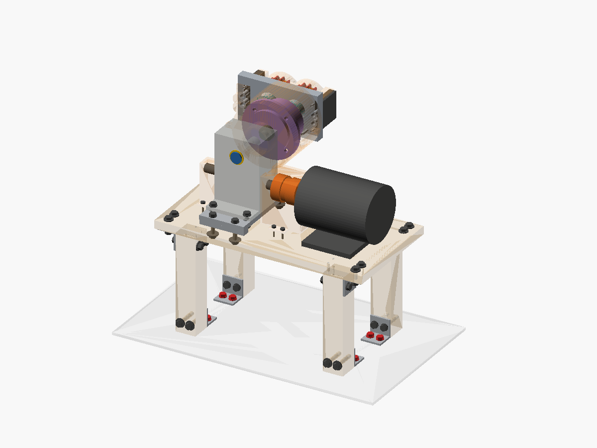
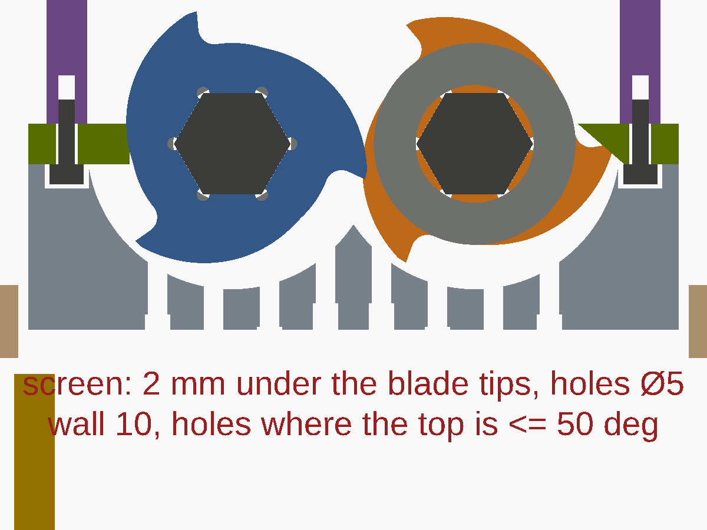

# Twin-shaft plastic shredder: design

A small, slow twin-shaft shredder for 3D-print waste (PLA, PETG, ABS/ASA, PC, nylon).
- **Made from your stock** (mild-steel flat and bar): blades, spacers, end plates, combs, walls, sleeves.
- **Made on your machines:** Roher TBL-20/520 lathe, SIEG X3.5D mill, Jingyan CNC4030, MK3S printer.
- **Bought, all from Amazon:** bearings, gearbox, jaw coupling, torque limiter, dowel pins, shaft steel and the **timing gears**. (Raw steel flat and the aluminium for the screen and the pin flange may be bought locally.)
- **Driven by** your salvaged 375 W motor.

Every number comes from [`design/params.py`](../design/params.py). The checks are in
[`docs/CALCULATIONS.md`](CALCULATIONS.md) ("CALC §n"), generated by `calc/calc.py`. The model
is the SolidCraft design [`cad/shredder_assembly.sc`](../cad/shredder_assembly.sc), built from
the parameters by [`cad/solidcraft`](../cad/solidcraft/README.md); the parts come out of it:
- STEP files in `cad/step` and STL files in `cad/stl` (for AXIS CAM and printing);
- DXF outlines in `cad/dxf`;
- pictures in `cad/png`.

The design checks (alignment, clearances, envelopes) are still the OpenSCAD ones in
[`cad/checks.scad`](../cad/checks.scad), run on the OpenSCAD sources in `cad/`.

Run `make all` after changing any parameter. It fails if any strength, fit or interference
check fails. `make variants` re-checks the fit for the parts whose sizes may differ
(gear hub length 12 / 22, the TL350's sprocket 1 mm deeper, gearbox hub width, motor shaft length, and the pin flange set 1 mm closer / further or on a longer spacer).

> **Do not connect the motor until every item in §8.4 ("Before the first power-on") is done.**

## 1. The machine in one table

| | |
|---|---|
| Type | Twin shaft, 1:1 counter-rotating, **28 rpm** |
| Blades | 16 (8 per shaft) + 2 spares. Ø68, 8 mm, 3 hooked teeth, hex bore, cut from your 70x10 flat |
| Cutting chamber | 132 x 132 mm (16 slots: 8 mm blade + 8.4 mm spacer) |
| Shafts | Bought **4140** bar 1¼" turned to Ø30: hex 25.05 AF under the blades, Ø25 journals, 60 mm apart |
| Bearings | 6 x **NA4905 needle bearings** (25x42x17): 2 per shaft in the end plates, oil-sealed, and 1 per shaft in the **outboard bearing plate** outside the gears. Located lengthwise by an AXK3047 thrust bearing at the drive end and crinkle washers at the free end |
| Timing gears | 2 x **bought** spur gear, **module 4, 15 teeth**, pitch Ø60, face 30, **hardened teeth**, re-bored Ø25 with an 8 mm keyway. Each gear sits **between two bearings**: the drive-end bearing and the outboard bearing plate (§2 item 5) |
| Drive | Your motor (1420 rpm) → **jaw coupling** → worm gearbox NRV063, i = 50, on its feet, its output **on shaft A's axis** → **pin flange** (4 pins) → the 30T sprocket plate of the **TL350-2 friction torque limiter on shaft A**. No belt, no chain |
| Torque | **45 N·m** operating. The limiter is set to **55 N·m** and can pass at most 63 N·m. A hard jam (a screw) peaks at ~115 N·m; everything is checked for it |
| Capacity | Thin-walled prints and infill. By the deliberately cautious model in CALC §2, solid sections of ~1.3 mm (PC) to ~2.1 mm (ABS) per bite; cut thicker solid lumps smaller first |
| Output | **Pieces of 5 mm or less.** A fixed aluminium **screen** right under the blades (2 mm below the tips, Ø5 holes): what passes falls into the drawer, what does not is carried round again and cut until it does (§5.8) |
| Safety | Hopper lid with a **guard-locking** interlock; the **screen is the guard from below** (screwed on, Ø5 holes); drive-end guard, coupling guard, E-stop, contactor starter |

## 2. Decisions you should know about

1. **Your stock is mild steel** (S235, Sy 235 MPa). Plates, blades, spacers, combs, walls,
   sleeves and test parts are made from it.
2. **Needle bearings instead of ball bearings** (your choice, all on Amazon).
   - The shafts are only 60 mm apart, so no ball bearing bigger than a 6005 fits.
   - A jam at a stripper comb loads the drive-end bearing hardest. The 6005 limited the machine
     to ~50 N·m and had no reserve for hard jams.
   - The NA4905 is the same bore and smaller outside (42 mm). It carries **3x the load** even
     at the lowest Amazon rating (C0 20.5 kN; branded ones 30-34 kN).
   - Needle bearings carry no lengthwise load, so a thin thrust needle bearing at the drive end
     does that (CALC §7).
3. **Torque limiter on shaft A** (2026-11-15; before, it was on the gearbox output).
   - If something hard stops the blades instantly, everything still turning behind the jam must be stopped by it. A spinning worm would
     slam the shafts with hundreds of N·m (its inertia counts the gear ratio squared), so the limiter must be after the gearbox.
   - The TL350-2 friction limiter sits on shaft A's drive end, turned round (flange end outward); the pin flange drives its 30T sprocket plate. Only the shafts,
     blades, gears and the limiter's hub are after it: the hard-jam peak is ~115 N·m (CALC §3b). (On the gearbox side, its sprocket and the pin flange would
     be after it too and push the peak up: the gears and the screen would not pass.)
   - Its setting is checked on the bench with a lever and a weight (§6.3).
4. **The shafts are bought 4140 bar, not your mild-steel Ø30 bars.**
   - With the hard-jam peak included, mild steel misses the check at shaft A's gear keyway
     (CALC §4b-4c).
   - One 3-ft length of 1¼" 4140 makes both shafts. Turn it to Ø30 first, then machine it like
     before.
5. **The timing gears are bought, hardened, and each one sits between two bearings** (your choice, 2026-11-13, after review 7).
   - Before, each gear sat 42 mm OUTSIDE the drive-end bearing on the Ø25 shaft. Under load the two shafts bend apart, the gears tilt, and the teeth carry the
     load on only a short part of their width. Worked out properly (ISO 6336), the home-made m1.5 gears failed badly, and so would any gear mounted like that.
   - Now an **outboard bearing plate** (2 layers of 100x10 flat, on 2 steel pillars from the drive cap layer, held by 4 long M8 12.9 screws) carries a third NA4905 on
     each shaft, outside the gear. The gear is straddled, and each shaft runs in three bearings (CALC §4, §7b).
   - The gears are **bought m4 z15 spur gears with hardened teeth** (pitch Ø60, face 30). m4 z15 rather than m3 z20 (the same diameter) because the m3 misses the
     hard-jam bending check by a little (CALC §6). The contact stress at Ø60 is above ~600 MPa even with perfect alignment, so **unhardened gears would pit**.
   - The CALC assumes a cheap gear's accuracy (ISO grade 9) and ±0.02 mm bearing seats, so it uses a face load factor of 3-4.6 (the load bunches at one end of the
     teeth). It still passes: bending SF 1.27 at the hard-jam peak. **Pitting** is rated as a life: with all of the motor's torque through the gears all the time,
     the gears last **~280 hours of cutting** if the teeth are at least HRC 50 and greased with a VG 220+ grease (CALC §6). So they are a **wear part**: buy 2 spares.
   - Shaft A is 366.2 long (it also carries the torque limiter), shaft B 279.2.
6. **The motor's real output is probably ~250 W, not 375 W** (1.7 A at 220 V is only 374 VA in).
   - At 28 rpm it gives ~46 N·m at shaft A, so the shredder runs it near its rating.
   - It is rated **S2 30 min**: run about 30 minutes, then let it cool.
7. **A fixed screen right under the blades** (2026-11-15, your idea: "the shape of the bottom of the blades with holes, so only small pieces pass and the rest keeps shredding").
   It replaces the vibrating screen, its motor, springs, chute and PWM knob, the wire-mesh grid and its cleats, the fixed upper front panel, the drawer switch and the side skirts.
   - One **aluminium block** (6061 or 6082) machined on the CNC4030: its top is two arcs **2 mm under the blade-tip circles**, meeting in a ridge between the shafts and
     rising to the combs; flat wings screwed up against the combs' underside with 4 x M4. Wall 10 mm, **Ø5 holes** on an 8 mm hex pattern where the top is no steeper than 50°.
   - What passes a hole falls into the drawer. What does not is dragged round by the teeth to the comb, cut again and fed back into the bite.
   - **It is the guard from below**: a finger cannot reach the blades through a 10 mm long Ø5 hole (ISO 13857: ≥ 5 mm needed). So there is no grid and no drawer switch;
     the drawer is a plain full-height box.
   - **Honest risk.** Screens are usual on single-shaft and four-shaft shredders. On a twin-shaft machine the oversize has to be cut at the combs before it can come back
     round, so the limiter will slip more often, and soft, stringy plastics (PETG, nylon) may pack the corner under the combs. If that happens: STOP, pull the drawer, undo
     the 4 screws from below, drop the screen out, clean it (§8.3). Bigger holes (6-8 mm, `SCREEN_HOLE_D`) pass more. Try it on your own waste early (§8.4).
8. **Check these on the parts you receive, put the real values in `params.py`, then run
   `make all`:**
   - the **bought gears**: hub length and OD (`GEAR_HUB_L`, `GEAR_HUB_D`; the model uses 18 and Ø45), and that the teeth are hardened but the bore is soft (§5.7);
   - the TL350: its sprocket plate's position from the flange-end face (`TL_CM_OFFSET`, 12) and thickness (7.2), and that the plate is soft enough to drill (§6.2);
   - the gearbox's real size and feet;
   - your **motor's shaft**: diameter and length (the coupling's bore; the model uses Ø12 x 40, `MOTOR_SHAFT_L`).
9. **No belt and no chain** (2026-11-15, your choice: "I don't think we really need a belt", then "why do we need the other belt?").
   - The motor drives the worm through a **jaw coupling**, on the same axis. 1420 rpm / 50 = 28.4 rpm at the gearbox output = the shaft speed.
   - The gearbox's output is **on shaft A's axis**, outboard of it. A **pin flange** (made from aluminium, keyed on the gearbox output shaft) carries 4 hardened
     Ø8 dowel pins; they reach into 4 Ø8.5 holes you drill in the TL350's own 30T sprocket plate. The sprocket's teeth carry nothing now.
   - The pins only pass torque: they slide freely in their holes (0.25 mm play), so there is no side load on the gearbox or on shaft A, and a little misalignment
     is taken by the play. Line the gearbox up within it (§6.1).
   - Gone: the V-belt, both pulleys, the belt guard, the chain, the gearbox's 30T sprocket, the idler and its tensioner, the stop collar and the chain guard.
     New: the jaw coupling with a printed **coupling guard**, a printed cap over the gearbox's second input shaft, the pin flange and 4 dowel pins.
   - Your bronze bar (under Ø50) is not used: it is too small for the slipping disc of a home-made limiter, and the bought TL350 is already the limiter.
   - The motor sits on the deck coaxial with the worm: shim its feet so its shaft lines up with the worm's (within ~0.2 mm, check with a straight edge across the coupling hubs).

## 3. How it works

The two shafts carry alternating blades and spacers. Each blade on one shaft runs in the gap
between two blades on the other shaft, with **0.20 mm side clearance** (nominal). The blades
overlap by 8 mm, so a tooth drags plastic down and shears off an 8 mm strip against the
neighbouring blade.

The shafts turn so their inner sides move down. The gears keep them in step. **Stripper combs**
on the outside of each shaft scrape plastic off the spacers. Consecutive blades on a shaft are
rotated 15°, so the 24 teeth on each shaft bite one after another.

Coordinates used everywhere:
- x runs along the shafts, from x = 0 at the inside face of the drive-end plate to
  x = 132.2 at the free-end plate;
- shaft A, driven by the gearbox (on its axis), is at y = −30; shaft B is at y = +30;
- z points up, with the shaft centres at z = 0.

**What sits on each shaft at the drive end, going outward from the chamber:**
1. clamp sleeve (Ø30, runs in the oil seal);
2. NA4905 inner ring;
3. collared sleeve, whose collar presses the thrust bearing against the plate;
4. gear (bought m4 z15, keyed), teeth first, hub outward;
5. a 3.5 mm Ø30 sleeve, the **outboard NA4905** (in the outboard plate), then the outer sleeve: 3.5 mm on B, **28.5 mm on A**;
6. on shaft A only, the **TL350-2 torque limiter**, nut end inward, flange end outward (its 30T sprocket plate, 12 mm from the outer end, takes the 4 pins);
7. end cap and M10 screw.

**At the free end:**
1. clamp sleeve;
2. inner ring;
3. collared sleeve, with crinkle washers and a thrust bearing between its collar and the plate;
4. end cap and screw.

Everything on a shaft is clamped between its two end caps (CALC §8).

## 4. Parts

### 4.1 Made by you

| # | Part | Qty | From | Machine | Key dimensions |
|---|---|---|---|---|---|
| 1 | Blade (phase variants v0-v3) | 16 + 2 | 70x10 flat | SIEG (face), CNC | Ø68, **8.00 ±0.02**, hex bore **25.10 AF fitted to the shaft** (25.08-25.13), Ø3.2 corner reliefs |
| 2 | Spacer | 15 | Ø55 bar | Lathe | OD 50, bore 29.2, thickness from the **stack schedule** (nominal 8.40) |
| 3 | End spacer (shaft B, drive end) | 1 | Ø55 bar | Lathe | as 2, nominal 8.20 |
| 4 | Shaft A | 1 | bought 4140 bar | Lathe, SIEG | 366.2 long; journals Ø25 h6, hex, 2 keyways (gear, torque limiter); CALC §11 |
| 5 | Shaft B | 1 | bought 4140 bar | Lathe, SIEG | 279.2 long; 1 keyway (gear); CALC §11 |
| 6 | Inner plate layer | 2 | 70x10 flat | SIEG | 170 x 70; **Ø42 x 7 seal bore** from the chamber side, then **Ø36** (bearing shoulder) |
| 7 | Outer plate layer | 2 | 70x10 flat | SIEG + boring head | **Ø42 H7** through, the two bores **60.00** apart |
| 8 | Cap layer | 2 | 70x10 flat | SIEG + boring head | **Ø42 H7 x 7 deep** from the inner face, then Ø32 through; 4 x **M8** tapped through at (±80, ±9) (also 9.5 deep into the outer layer) |
| 8b | **Outboard plate layers** (ob1, ob2) | 2 | **100x10 flat** (bought locally, 400 mm) | SIEG + boring head | 180 x 100, **its centre 3 mm above the shaft axes** (bottom edge 47 below them); **Ø42 H7 pocket 8.5 deep from the joint face of each layer**, Ø32 through the last 1.5; the two pockets **60.00 apart**; 4 x Ø9 at (±80, ±9); 2 dowels Ø6 at (±55, −40) |
| 8c | **Pillars** | 2 | **60x15 flat** (bought locally, 150 mm) | SIEG | **15 (y) x 60 (z) x 58.00** (both equal ±0.01, ends square and parallel), two Ø9 holes 18 apart through the length; they stand on the cap at y = ±73 … ±88 (over the comb and wall screw heads: fit those first) |
| 9 | Drive clamp sleeve | 2 | Ø55 bar | Lathe | **OD 30 smooth (seal surface)**, ID 25.05, made **10.60**, faced to fit (nominal 10.50, §7.3) |
| 10 | Free clamp sleeve | 2 | Ø55 bar | Lathe | OD 30 smooth, ID 25.05, 10.50 (A), 10.70 (B) |
| 11 | Collared sleeve, drive | 2 | Ø55 bar | Lathe | ID 25.05, body Ø30 x 7, collar Ø46 x 4 |
| 12 | Collared sleeve, free | 2 | Ø55 bar | Lathe | ID 25.05, body Ø30 x 9, collar Ø46 x 4 |
| 13 | End cap | 4 | Ø30 bar | Lathe | Ø30 x **10**, hole Ø10.5 |
| 14 | Stripper comb | 2 | 50x10 flat | CNC | 132.2 x 25 x 10, slots 9.0 wide; underneath 2 x M4 tapped 9 deep at x = 44.1 and 88.1, 74 from the machine centre (the screen's screws) |
| 15 | Wall | 2 | 50x10 flat | SIEG | 132.2 x 50 x 10 |
| 16 | Gearbox output shaft | 1 | **bought 4140 bar** | Lathe, SIEG | Ø25 h6 x 103.3 through the gearbox's hollow output; keyway for the gearbox AND for the pin flange; circlip groove on the far side; Ø36 x 3 spacer; `cad/dxf/output_shaft.dxf`, CALC §3a |
| 16b | Gearbox rails | 2 | 50x10 flat | SIEG | slotted ±6 mm along the shafts (to set the pin flange's 2 mm gap), bolted through the deck into the leg frame |
| 17 | **Pin flange** | 1 | **aluminium round 6061, Ø125 x 50** (bought locally; S235 steel also works) | Lathe, SIEG, broach | disc Ø120 x 12 + hub Ø50, 45 overall; pocket Ø36 x 20 in the face; bore Ø25 H7 x 25 behind it with the **8 mm keyway** (broached) and 1 x M6 grub screw over the key; **4 x Ø8 reamed for a press fit** on PCD 101 at 45°, through the disc; press in 4 hardened dowels Ø8 x 32 flush with the back; `cad/dxf/pin_flange.dxf`, §6.2 |
| 17b | **Drill the TL350's sprocket** | 1 | the TL350's own 30T sprocket | SIEG + DRO | 4 x **Ø8.5** through the plate at **(±35.71, ±35.71)** from the bore centre (PCD 101), between its Ø89 friction area and the tooth root; 1:1 template `cad/dxf/sprocket_drill.dxf`; §6.2 |
| 18 | TL setting stub + chain-whip lever | 1 + 1 | Ø30 bar, 50x10 flat | Lathe, SIEG | `cad/tlfix.scad` (§6.3) |
| 19 | Blade torque test lever | 1 | 50x10 flat + Ø12 hardened pin | SIEG | `cad/testlever.scad` (§5.6) |
| 20 | Stacking mandrel | 1 | Ø30 bar | Lathe | Ø24.9 x 150 (§7.1) |
| 11b | **Outboard sleeves** | 4 | Ø55 bar | Lathe | OD 30, ID 25.05, ends flat and square, in the clamp chain: **3 x 3.50** (inside both outboard inner rings, outside B's) and **1 x 28.50** (outside A's: the torque limiter sits on it) |
| 20b | **Gear rework** (bought m4 z15, A and B identical) | 2 | bought | Lathe, broach | re-bore **Ø25 H7**, broach the **8 mm keyway**, like the pin flange; §5.7 |
| 21 | Printed parts | | PETG | MK3S | hopper (collar, funnel, lid + pads), drive-end **gear band** + **hood** (two halves), free-end cover, **coupling guard + stub cap**, drawer handle (`cad/stl`) |
| 22 | Plywood | | 18 mm ply, 10 mm ply, 45x45 timber | saw / router | base plate (cut-out 132.2 x 166), bin cabinet (2 sides, back, floor), drawer (full-height front 192.2 x 314, bin 154 x 176 x 291 in 10 mm ply), drive deck + legs (`cad/dxf`) |
| 24 | **Screen** | 1 | **aluminium block 6061 / 6082, about 136 x 165 x 45** (bought locally) | CNC4030 | finished 131.2 x 161 x 41: top two arcs R36, bottom two arcs R46 round the shaft axes, wings 80.5 from the centre; 216 x Ø5 holes on an 8 mm hex pattern; 4 counterbores + 6 pockets; `cad/stl/screen.stl`, `cad/dxf/screen.dxf`; §5.8 |

The cut list is in CALC §10. **Cut the plate layers and blade strips from the 70x10 flats first,
exactly to plan**: there are only 20 and 34 mm to spare. The outboard plate needs **400 mm of
100x10 flat** (buy it locally).

### 4.2 To buy (Amazon)

| Item | Qty | Amazon (example listing) |
|---|---|---|
| 4140 alloy steel round rod **1¼" x 3 ft**, cold-worked annealed | 1 | [B09Q3NW324](https://www.amazon.com/Alloy-Steel-Round-Diameter-Length/dp/B09Q3NW324) |
| **NA4905** needle roller bearing with inner ring, 25x42x17 | **6** (+1) | [NMD B0CD14LTPC](https://www.amazon.com/NMD-NA4905-Bearing-Inner-25X42X17/dp/B0CD14LTPC) or [B0F5HJ3RQF](https://www.amazon.com/NA4905-25x42x17-4544905-Bearing-machined/dp/B0F5HJ3RQF) |
| **AXK3047 + 2 x AS3047** thrust needle bearing set | **4** (one per shaft end) | [B0C6DVPHCF](https://www.amazon.com/TMP1105-AXK3047-Bearing-Bearings-30x47x4mm/dp/B0C6DVPHCF) |
| Oil seal **TC 30x42x7** | 4 | [EAI B07YGT7LD9](https://www.amazon.com/30X42X7-EAI-Spring-Coating-30mmX42mmX7mm/dp/B07YGT7LD9) |
| Crinkle washer 30x39x0.5 | 6 | [uxcell B01E0CSZIM](https://www.amazon.com/clp/B01E0CSZIM) |
| **Spur gear module 4, 15 teeth, hardened teeth** (45# / C45, induction / high-frequency hardened **≥ HRC 50, case ≥ 0.5 mm**, face ≥ 30, with a hub, soft bore ≤ 25) | 2 (+ 2 spares: a wear part) | **to be chosen** (Amazon search blocked on the Windows PC); §5.7 |
| **Flat bar 100 x 10 mild steel, 400 mm** (the 2 outboard-plate layers) + **flat bar 60 x 15, 150 mm** (the 2 pillars) | 1 + 1 piece | **a local metal shop** (raw steel is the one exception to the Amazon-only rule) |
| **Gear grease**: EP2 or open-gear grease, base oil **ISO VG 220 or thicker** | 1 tube | any; the pitting life in CALC §6 assumes it |
| Optional: Kasenit-type case-hardening powder (for the blades, §9) | 1 small tin | search "Kasenit" / "case hardening compound" |
| **M8 x 100 socket screws, 12.9** (outboard plate ties) + **12 hardened washers ISO 7089 M8 300HV**; M5 x 12 (hood, 4); M8 x 16 (free-end cover, 4) | 4 + 12 + 4 + 4 | any; use a torque wrench (§7.2 step 9) |
| **Worm gearbox NRV063-VS, i = 50**, Ø19 input shaft, Ø25 hollow output | 1 | [Treayes B0FKB4H9B4](https://www.amazon.com/dp/B0FKB4H9B4) (choose 50:1; **ships to Israel**, checked 2026-11-15). Its 50:1 torque rating and output keyway are not stated: ask the seller for ≥ 126 N·m and an 8 mm keyway. Measure the housing and feet before drilling the sub-plate (`GB_*` in `design/params.py` are placeholders) |
| **TL350-2 friction torque limiter** with #40 30T sprocket, bore 25 + keyway (it goes on shaft A) | 1 | [B0GJ689QR6](https://www.amazon.com/Overload-Protection-Industrial-Machinery-Transmission/dp/B0GJ689QR6) (confirm the sprocket and bore with the seller) |
| **Dowel pins Ø8 x 32, hardened** (ISO 8734 / DIN 6325, m6) | 4 (+ spares) | **to check** (search "8mm x 32mm dowel pin hardened"; check that it ships to Israel) |
| **Jaw (spider) coupling L090** (or L075), bores **19 mm** (worm) and **your motor's shaft** | 1 | to be chosen (e.g. "L090 jaw coupling 19mm"); measure the motor shaft first |
| A short piece of #40 roller chain (about 33 links) | 1 | only for the limiter's setting fixture (chain whip, §6.3); any #40 chain |
| Metric keyway broach set (8 mm broach, 25 mm bushing) | 1 | [B0BRV75RNS](https://www.amazon.com/Lidhujnk-Metric-Collared-Bushing-Processing/dp/B0BRV75RNS) |
| Keys 8x7 (bar), M10 x 30 socket screws (4), M6/M5/M4 screws, dowel pins Ø6 (end plates 4, outboard plate 2) | | |
| **Lid: Pizzato FS 3096D024-F7** guard-locking switch: locked with the solenoid **de-energised** (power to unlock), 24 V, comes with its adjustable jointed actuator | 1 | [B07HCCFTQB](https://www.amazon.com/dp/B07HCCFTQB). Not the "E" version: that one unlocks when the power fails |
| Floor/bench anchors M8 (8), steel angles 40x40x4 (4 for legs + 4 for feet) | | the drive deck is held down against the gearbox's reaction torque (CALC §3a) |
| Contactor + thermal overload (~1.9 A), START/STOP, mushroom E-stop, **24 V DC supply ≥ 30 W** (the lid solenoid only), on-delay timer relay | | §8.2 |
| Screen: 4 x **M4 x 16 socket screws** (8.8); wall screws M5 (already in the comb/wall row) | 4 | any |
| **Aluminium block 6061 / 6082, about 136 x 165 x 45** (the screen) | 1 | a local metal shop (raw stock) |

All of these were found on Amazon (Nov 2026). Check that each listing ships to Israel before
ordering.

## 5. Making the parts

### 5.0 Tolerances that matter (everything else ±0.1)

| Feature | Tolerance | Why |
|---|---|---|
| Blade thickness | 8.00 ±0.02, flat | side clearance |
| **Blade face positions in each stack** | ±0.03 from the schedule (§7.1) | errors must not accumulate |
| Bearing seats Ø42 (outer layers + caps, outboard layers) | H7 (42.000-42.025); bore each end's outer layer and cap together, the two ends doweled; every seat within **±0.02** of its DRO position | bearing fit; three bearings in line on each shaft (CALC §4, §6) |
| Bearing-seat centre distance (end plates AND outboard plate) | 60.00 ±0.02 | gear mesh, three bearings in line |
| Pillar length | 58.00, both within ±0.01, ends square and parallel | the outboard plate parallel to the cap |
| Journals Ø25 | h6; an NA4905 inner ring should *slide* on | assembly |
| Clamp sleeve OD 30 | h8, Ra ≤ 0.8 (turn fine, polish) | oil seal lip |
| Hex across flats | 25.05 ±0.03 | blade fit |

### 5.1 Blades: SIEG, then CNC4030
1. Saw the 70x10 flats per CALC §10:
   - from the 1300: two 380 mm strips (5 blades each) and three 170 mm plate layers;
   - from the 1170: two 308 mm strips (4 blades each) and three layers.

   **Face both sides of every strip to 8.00** on the SIEG.
2. **Hold-down.** Blade centres are 72 mm apart, 46 mm from each strip end. Drill:
   - **Ø5.5 at each blade centre**, for an **M5 socket screw with a Ø10 washer** that holds the
     bore slug;
   - **Ø5.5 at every gap between blades**, at y = ±29;
   - two holes at each end, 6 mm in, at y = ±29.

   Screw the strip to an MDF or aluminium sub-plate with **M5 socket heads (Ø8.5)**. Use a tool
   stickout of ≥ 16 mm so the collet nut clears the heads (CALC §9).
3. **Test cut first,** on a 50x10 offcut: a 40 mm full-depth slot and one hex bore with its
   reliefs. If it chatters or the slot measures over 6.4, use ae 0.2 and 300 mm/min.
4. **Toolpaths in AXIS CAM** from `cad/stl/blade_vN.stl`, material **Mild steel 1018**:
   - tools: **Ø6 carbide 3-flute (AlTiN)**, and **Ø3 carbide** for the corner reliefs;
   - 7500 rpm, adaptive, ae 0.3, 400 mm/min, 2 depth levels of 4 mm;
   - finish pass 0.1;
   - ramp entries ≤ 2°. Never plunge the Ø6.

   Order per blade:
   1. six Ø3 corner reliefs, 8.2 deep;
   2. the hex bore with the Ø6, leaving 0.1;
   3. try the real shaft in the bore and set the finish so the blade **slides on by hand
      without rocking (25.08-25.13 AF)**;
   4. the outer profile, with 3 tabs (4 wide, 1.5 high) on the backs of the teeth.

   About 50 minutes per blade.
5. **Mark each blade.** Make 4 of each variant v0-v3, plus 2 spares. Spot-mark the bore corner
   that is v x 15° from the tooth tip, and stamp the variant number and a "T" on the top face.
6. Break the tabs flush and deburr the faces lightly. Keep the edges sharp. **Write the
   thickness on every blade.**

### 5.2 Spacers, sleeves, end caps: lathe
1. **Spacers** from the Ø55 bar: OD 50, bore 29.2. Part them off at ~8.8 and finish the second
   face on a Ø29.2 stub mandrel (parallel within 0.01); final thickness comes from §7.1.
2. **Clamp sleeves**: OD 30 h8, **turned fine and polished**, because the oil seals run on them.
   ID 25.05. Drive sleeves 10.60; free sleeves 10.50 (A) and 10.70 (B).
3. **Outboard sleeves** (4): OD 30, ID 25.05, from the Ø55 bar; face both ends flat and square: **three 3.50 long** (inside both outboard inner rings, outside B's) and **one 28.50** (outside A's: the torque limiter's flange end sits on it).
3a. **Pillars** (2, SIEG): from the 60x15 flat: two pieces, then face them together to **58.00 long, both equal within ±0.01**, ends square and parallel (fly-cut on parallels). Drill the two Ø9 holes 18 apart through the 58, centred on the 15 width (from both ends).
3b. **Collared sleeves**: ID 25.05, body Ø30 (h8; it passes through the thrust bearing and the
   cap hole), collar Ø46 x 4. The collar faces must be flat and square: they carry the thrust
   bearing.
   - drive: body 7, total 11;
   - free: body 9, total 13.
4. **End caps** Ø30 x 10, hole Ø10.5, from your Ø30 bar.

### 5.3 Shafts: bought 4140, lathe then SIEG
1. Saw the 4140 bar into shaft A (≥ 370), shaft B (≥ 283) and the gearbox output shaft (≥ 124). (No tailstock: every lathe step is done **in the chuck**, from one end at a time.)
2. **Drive side first.** Grip the bar in the 3-jaw on the middle (the part that becomes the hex), ≤ 140 mm sticking out:
   face the end to length mark, turn the drive-side journal **Ø25 h6** (its length is in CALC §11: about 132 on A, 110 on B). The overhang is short enough: finish with 0.05 mm
   passes and two spring passes, then measure at both ends of the journal with the micrometer and correct any taper.
   Gauge with an NA4905 inner ring: it must slide on.
3. **Free side.** Turn the shaft round, grip on the finished drive journal (soft jaws or a split bush), and **indicate the journal true to ≤ 0.01** next to the jaws
   (shim a jaw or use a 4-jaw). Face to the overall length (CALC §11), turn the free-side journal Ø25 h6 and the Ø30 for the hex.
   The two journals must run true to each other: three bearings carry each shaft.
3b. Both ends (in the same chuckings): drill Ø8.5 x 30 and tap M10 x 25.
4. **Hex on the SIEG** with a 5C hex collet block: a Ø16 end mill to 12.525 from the axis on
   each of the 6 flats, opposite flats checked at 25.05. Punch **corner 0**.
5. **Keyways** 8 JS9 x 4, on the corner-0 side, per CALC §11: the gear seat (the gear's whole bore, hub and teeth) on both shafts and
   the torque-limiter seat on A (under its hub).
6. Annealed 4140 machines like a tough medium-carbon steel. Use sharp carbide and coolant.

### 5.4 End plates: SIEG
1. **Clamp all six layers together.** Square the edges, then drill through all six:
   - Ø10 pilots at the shaft centres (y = ±30, z = 0);
   - the dowel holes at (±55, −27), reamed Ø6.
2. **Bore Ø42 H7** with the boring head, 60.00 apart by the DRO:
   - **outer layer + cap of each end clamped together** on the dowels;
   - the outer layer through, the cap **7 deep** from its inner face;
   - then the cap's Ø32 through.
3. **Inner layers:** Ø42 x 7 deep from the chamber face (seal bore), then Ø36 through.
4. Then the other holes per `cad/plate.scad`: joining, comb, wall and guard holes, hopper top
   holes, feet. Joining screws are **M6 x 20**. The 4 guard holes at (±80, ±9) are **M8**: drill Ø6.8 through the cap and
   9.5 deep into the outer layer (clamped together), tap both.
5. **Outboard plate** (2 layers of 100x10, 180 long):
   - clamp both layers together, square the edges, drill and ream the 2 dowels Ø6 at (±55, −40) and the 4 Ø9 holes at (±80, ±9);
   - set the DRO to the **same** origin as for the end plates: the shaft axes are on the plate's length centre, **3 mm below its height centre**; y = ±30.00;
   - **bore each layer separately from its joint face**: Ø42 H7, **8.5 deep**, then Ø32 through the last 1.5 (the step holds the bearing's outer ring);
   - ob2 only: 4 x M5 tapped through at (±76, ±28) for the hood;
   - dowelled together, the two pockets make the 17 mm bearing seat.

### 5.5 Combs, walls, printed and wooden parts
- **Combs:** CNC, 8 slots 9.0 wide running 3 mm past the blade tips; M6 tapped in the ends; underneath, the 3 Ø5.5 wall-screw holes and **2 x M4 tapped 9 deep** for the screen
  (x = 44.1 and 88.1, 74 from the machine centre, `cad/stl/comb_A.stl`).
- **Walls:** plain bars, M5 tapped in the ends and edges.
- **Printed (PETG, 4 perimeters, 40 %):** the parts in row 21.
- **Plywood:** row 22, from `cad/dxf/`.

### 5.6 Blade torque test (first finished blade, before making the rest)
This proves the mild-steel hex bore takes the torque. Its edges bed in slightly on first load
(CALC §5).
1. Clamp a shaft by two hex flats (soft jaws). Put one blade on the hex next to the journal.
2. The **test lever** pivots on the journal. Its **Ø12 hardened pin** sits on a tooth's hook
   face, with the lever horizontal and turned against the cutting direction
   (`cad/png/blade_torque_test.png`).
3. Measure the play at a tooth tip with a dial indicator.
4. Hang **11.9 kg at the 500 mm hole** for 10 seconds, 10 times. The lever's own weight adds
   about 5 N·m, for 63 N·m, the most the limiter can pass.
5. **Accept if the play grew ≤ 0.05 mm.** Otherwise make the bore fit tighter before making
   the other blades.

### 5.7 The gears: bought, re-bored and keyed
Both gears are the same bought part: **module 4, 15 teeth, 20°, pitch Ø60, outside Ø68, face ~30, with a hub, teeth hardened** (45# steel,
induction or high-frequency hardened). The model is `cad/gear.scad`; the strength checks are CALC §6.

1. **Before buying,** read the listing: the **teeth** must be hardened to **at least HRC 50, case depth at least 0.5 mm** (the pitting and hard-jam checks need both, CALC §6), the **bore and hub** soft (otherwise you cannot re-bore and broach them). Face width 30 or more.
   The bore must be 25 or smaller.
2. **On arrival,** file-test: a file must skid on a tooth flank and bite in the bore. Measure the hub length and OD and enter them as `GEAR_HUB_L`, `GEAR_HUB_D`, then `make all`.
3. **Re-bore Ø25 H7** on the lathe: grip the hub in the 3-jaw, **indicate the tooth tips true to ≤ 0.02**, bore to a hand slide fit on a Ø25 h6 offcut (25.00-25.03).
4. **Broach the 8 mm keyway** with the broach set and its 25 mm bushing (the same as for the pin flange), through the whole bore.
5. **Backlash:** put both gears on two Ø25 pins 60.00 apart (the end-plate bores, or the outboard plate). They must turn freely with **0.05-0.30 mm** of backlash
   at the pitch circle (a dial on a tooth). Less: do not use them.
6. Shaft B's gear needs no special angle: with 15 teeth (odd) a gap of B faces a tooth of A. Turn shaft B until the gears mesh, then fit its key.
7. Grease the teeth with an EP grease whose base oil is **ISO VG 220 or thicker** (re-grease every 20 hours). Look at them every 20 running hours (§8.3).
8. **They are a wear part.** On the conservative rating (all the motor's torque through the gears, all the time) they last about 280 hours of cutting (CALC §6); in real use longer. Keep the 2 spares.

### 5.8 The screen (aluminium, CNC4030)

The part is `cad/stl/screen.stl` (as machined, wings up); `cad/dxf/screen.dxf` has its cross-section and the plan with every hole.
1. **Stock:** a block of 6061 or 6082 about 136 x 165 x 45. Square it to **131.2** (along the shafts) x **161** x 41 high.
2. **Top (wings up):** rough, then finish the two arcs (R36 round axes 60 apart, 30 each side of the centre) with a Ø6 ball end along the length, stepover ≤ 0.3.
   The flat wing tops are the reference: they bear on the combs.
3. **Pockets** in the wing tops: 6 x Ø11 x 6 deep at x = 20, 66.1, 112.2, 71 from the centre (the heads of the wall screws under the combs).
4. **The underside stays flat** (the block's own face, 41 below the wing tops). Only the top is 3D.
5. **Holes, from the flat underside** (flip it, wing tops down on parallels): 216 x Ø5 on the 8 mm hex pattern from the DXF, drilled **straight up** through to the arcs
   (the drill starts on a flat face, so it does not wander). Then **relieve** each hole Ø6.5 from below so the Ø5 part is only 10 mm long: the depth is the same
   for every hole in a row along the shafts (the rows right under the shaft axes need none; the DXF/STL has the depths).
   Deburr both sides (a countersink, lightly): sharp burrs catch strings.
6. **Screws:** 4 x Ø4.5 through the wings at x = 44.1 and 88.1, 74 from the centre, **counterbored Ø8.5 from the flat underside up to 8 mm below the wing top**.
7. **Fit:** with the drawer out, hold the screen up under the combs from below (through the base plate's cut-out) and fit the 4 M4 x 16. Turn both shafts by hand:
   nothing may touch (blades 2 mm above it). To clean it, take it out the same way.

## 6. The drive

### 6.1 Layout (`cad/png/drive_iso.png`, `cad/png/drive_tl_section.png`)
- The **gearbox stands on its feet** on the drive deck, outboard of the drive end of the shredder, outside the bin cabinet,
  with its **output on shaft A's axis** (`cad/png/drive_tl_section.png`). The worm is 63 mm below it.
- **The motor drives the worm directly** through a **jaw coupling** on the gearbox's -y input shaft (the side away from the machine). It stands on the deck
  coaxial with the worm. Shim its feet until the two coupling hubs line up: a straight edge laid along both hubs, at the top and at the side, must lie flat (within ~0.2 mm).
  Leave the spider gap the coupling's maker gives.
- The **coupling guard** (printed) is a box over the coupling from the motor's face to the housing face, lowered over the shafts and screwed to the deck
  (2 feet, 4 x M5 x 20). The gearbox's **second input shaft** (+y side) gets the printed **stub cap** (2 x M5 x 20).
- **Gearbox output shaft** (part 16, 4140): it runs through the gearbox's Ø25 hollow output on its key, held by a circlip on the far side. On shaft A's side:
  a 3 mm Ø36 spacer and the **pin flange** (part 17), keyed, held by its M6 grub screw. The shaft ends 1 mm inside the flange's bore.
- The **pin flange's 4 pins** reach into the 4 holes drilled in the TL350's sprocket plate (part 17b). The flange's face is **2 mm** from the TL's flange-end face;
  its pocket clears A's end cap and M10 head. The pins only pass torque: no side load on the gearbox or on shaft A (CALC §3a).
- The gearbox stands on **two slotted rails** (part 16b) on spacer blocks. The slots let it slide along the shafts to set the 2 mm gap.
- **Line the gearbox up with shaft A** (it must be on the same axis within the pins' 0.25 mm play): shim under the rails until the pins slide into the 4 holes by
  hand, then turn shaft A a full turn by hand and check they never bind; a dial indicator on the flange's rim, read against shaft A's TL body, under ±0.2 mm.
- **Bolt the deck down.** When the shafts work, the gearbox's reaction torque tries to roll it about the output axis (up to ~0.8 kN on one row of feet). Fix each
  leg to the deck with a steel angle and 2 x M8, and each leg's foot angle to the floor or bench with 2 x M8 anchors or lag screws (≥ 2 kN pull-out each).
- **Fit the real parts:** put the measured gearbox, the TL350's sprocket position, gear hub and motor shaft sizes into `params.py`.
  Run `make all` and `make variants`, and use the regenerated deck, flange and guard drawings.

### 6.2 Fitting the limiter, the pin flange and the gears
- The gears (§5.7): keyed, **teeth toward the plates, hub outward**, then the 3.5 mm sleeve.
- Mesh shaft B's gear with A's before its key goes in. Any angle is fine.
- **Drill the TL350's sprocket** (part 17b) before you set the limiter: take the sprocket off the TL (it is the centre member, on the bush between the hub flange
  and the pressure plate). File-test the plate between the teeth and the friction area first: a file must bite (the plate is soft; only the teeth may be hardened).
  If it skids, the plate is hard: use a carbide drill, or ask the seller for a soft one. Clamp it on the mill, centre the DRO on its bore, drill **4 x Ø8.5** at (±35.71, ±35.71), deburr both faces, put it back.
- **Pin flange** (part 17): turn it from the Ø125 round, bore Ø25 H7, broach the 8 mm keyway, ream the 4 pin holes for a press fit and press the dowels in flush with
  the back face. On the output shaft: spacer, flange, key, grub screw.
- **Torque limiter on shaft A** (set first, §6.3): over the 28.5 mm outer sleeve, **nut end first** (flange end outward), keyed; then the end cap and M10 screw
  clamp its hub.
- Then slide the gearbox in along its rails until its pins enter the sprocket's holes and the gap is 2 mm (a 2 mm drill shank between the flange and the TL), and
  line it up (§6.1).

### 6.3 Setting the torque limiter (bench, before fitting it)
The TL350-2 slips when its friction discs are overcome. Its adjusting nut sets that torque.
1. Put the TL on the **setting stub** (part 18) clamped in the vise, keyed like shaft A
   (`cad/png/tl_setting.png`).
2. The **lever pivots on the stub's Ø25 pin** beyond the TL's adjusting nut. The **chain whip**
   (33 links of #40 chain) wraps the TL's sprocket, and both ends bolt to the lever's lugs near
   the pivot.
3. Hang **9.9 kg at the 500 mm hole**. Weigh it on a bathroom scale first, e.g. a filled water
   can. With the lever's own 6.6 N·m (the lever horizontal) that is **55 N·m**, the setting (the limiter is on shaft A).
4. Tighten the adjusting nut until the sprocket **just stops slipping** with the lever horizontal.
   Lift the weight and lower it gently 3 times: it must hold. With 2 kg more it must slip slowly.
5. Lock the nut as the TL instructions say. Run a few slips by hand to bed the discs in, then
   check again.
6. Re-check after the first hour of use and every few months.

The limiter is checked to pass at most 63 N·m (+15 % friction scatter) to shaft A quasi-statically,
and ~115 N·m for an instant at a hard jam (CALC §3b). The pins and the gearbox never see more than the
limiter passes (63 N·m).

## 7. Assembly

### 7.1 Stack schedule: make the spacers to fit the blades
The blades of A and B pass with 0.20 mm side clearance, so errors must not add up:
1. Stand the **stacking mandrel** (Ø24.9) on a flat surface.
2. Start the stack with blade 0 (shaft A) or the end spacer (shaft B).
3. After each part, measure the height of its top face with the dial caliper's depth rod, at 3
   places, against the schedule (CALC §8).
4. Face the **next** spacer so the following blade lands within **±0.03**: spacer =
   (scheduled top of the next blade − that blade's thickness) − current height.
5. Number the spacers and keep each stack in order.

### 7.2 Order of assembly
1. **End plates.**
   - Press the oil seals into the inner layers, lip toward the chamber.
   - Press an NA4905 *outer ring with its needles* into the outer layer of each end.
   - Assemble inner + outer + cap on the dowels with M6 x 20. The outer ring is clamped between
     the inner-layer shoulder and the cap step.
2. **Load each shaft.**
   - From the **drive end**: drive clamp sleeve (10.60), then an NA4905 **inner ring**. They
     stop at the hex.
   - From the **free end**: the stack in order:
     - A: blade 0, spacer ... spacer;
     - B: end spacer, blade 0 ... blade 7.
   - Blade orientation:
     - B: stamped face toward the free end;
     - A: stamped face toward the drive end;
     - blades 0-3 on corner 0, blades 4-7 one corner earlier against the rotation.
   - Then the free clamp sleeve and the free inner ring.
3. **Insert both shafts** into the drive-end plate from the chamber side. The clamp sleeves
   pass the seals (oil the lips) and the inner rings slide into the needles.
4. **Drive end, outboard:**
   - on the cap face: an AS3047 washer, the AXK3047 cage and a second AS3047 washer;
   - the drive collared sleeve, collar outward;
   - the gear, keyed, teeth first, then a 3.5 mm outboard sleeve and an NA4905 **inner ring**;
   - the comb and wall screws at that end must already be in (the pillars cover their heads);
   - the **2 pillars** on the cap's M8 holes, and the printed **gear band** over the gears, its C-shaped ears round the pillars;
   - the **outboard plate** (ob1 + ob2 on their dowels, the two NA4905 outer rings with needles pressed in) over both shafts, ob1 toward the gears;
   - the outer sleeve: 3.5 mm on B; **28.5 mm on A, then the torque limiter** (set, §6.3), flange end first, keyed;
   - end cap and M10 x 30 (on A it clamps the limiter's hub).
5. **Combs and walls** onto the drive-end plate.
6. **Free-end plate** over both shafts at once: seals oiled, inner rings into the needles.
   Bolt the combs and walls.
7. **Free end, outboard:**
   - on the cap face: 3 crinkle washers, AS3047, AXK3047, AS3047;
   - the free collared sleeve, collar outward;
   - end cap and M10 x 30.
8. **Clamp:** tighten all four M10 to **~8 N·m** (4 kN). The end caps never touch the shaft
   ends (1.5 mm clearance, CALC §8). The crinkle washers now push both shafts toward the free
   end, so their drive-end collars sit firmly on the drive thrust bearings.
9. **Line up the outboard plate with the shafts, then lock it.**
   - Put the 4 **M8 x 100 12.9** screws, each with **3 hardened washers** under the head, through ob2, ob1 and the pillars into the cap. Oil the threads. Snug only.
     The faces must be clean and dry (no oil, no paint): the plate is held by friction.
   - Turn both shafts by hand: the outboard plate finds its place on the bearings. Then tighten the M8 to **35 N·m with a torque wrench** in a cross pattern, a little at a time, turning the shafts between.
   - Both shafts must still turn as freely as before. If they got tight, loosen, turn, and tighten again.
   - The tie screws hold steel only. The printed hood is fitted later with its own 4 M5 screws into ob2 (§8.1); its wings have clearance holes round the washers.

### 7.3 Align the two stacks (feeler gauges)
1. Turn the gears by hand. At both ends and the middle, check the gaps on both sides of a B
   blade between its A neighbours:
   - 0.10 must pass on both sides;
   - the two sides should match within 0.05.
2. If one side is tight everywhere, the stack is offset. Face that shaft's **drive clamp
   sleeve** shorter by the offset (down to no less than 10.40) and re-clamp.
3. If it is tight in one place only, redo that spacer.
4. A full turn by hand must be free. Grease the gears, bring the gearbox in on its rails so the pins enter the sprocket (§6.2), then fit the
   guards. Fit the **screen** (§5.8 step 7) and turn by hand again: nothing may touch it.

## 8. Safety

### 8.1 Guards (all in `cad/`)
- **Hopper.** It continues the chamber walls 250 mm up to a lid. The lid has a **guard-locking
  interlock** (Pizzato FS 3096D024-F7).
  - It stays locked while the motor runs, and until the blades have stopped (§8.2).
  - Load with the lid open and the motor stopped, close the lid, press START. Push material with
    a stick only.
- **Outlet.** The **screen** is the guard from below (§2 item 7, §5.8). It is screwed to the combs (a tool is needed to remove it).
  - Its Ø5 holes are at least 10 mm long and the blades are 2 mm above them: ISO 13857 (Table 4) needs only 5 mm for round openings up to 6 mm. The ends are
    0.5 mm from the end plates; nothing else under the chamber is open (checks C40d, C40g).
  - So the cabinet below is only a dust box: sides, back, floor and a **plain full-height drawer** (no switch, no grid, no fixed front panel).
- **Drive-end guard, in three printed parts:**
  - the **gear band** round both gears, held between the cap and the outboard plate (it goes on before the plate);
  - the **hood**, two halves split through the shaft axes so they close round everything after assembly: a can round the torque limiter, the pins and the pin flange on shaft A, a bulge round B's end cap, and a tube round the flange's hub up to the gearbox housing face. Each half is held by 2 x M5 x 12 into ob2 (4 in all), and the halves are bolted together by 4 x M4 x 20 through ears on the can's sides; the M8 tie screws and their washers pass through clearance holes (the screws never clamp the plastic).
- The **free-end cover** goes over the rotating end caps; the **coupling guard** over the motor coupling, the **stub cap** over the gearbox's second input shaft.

### 8.2 Wiring
Mains → fuse → **contactor starter** with a thermal overload (~1.9 A) → motor.
- **Contactor coil circuit, in series:** E-stop (NC) → lid switch safety contacts → STOP (NC) → START (NO, self-holding).
  - Use the lid switch's contacts that are closed only when the lid is **closed and locked**.
  - A power cut stops the motor, and it stays stopped until START (no-volt release).
- **Lid unlocking.**
  - The FS 3096D024 is locked with no power. Its 24 V solenoid unlocks it.
  - Power the solenoid through an **on-delay timer relay**. The relay starts timing when the
    contactor drops out, and it closes only after the contactor has been off for **T_unlock**.
  - Set T_unlock = **max(1.0 s, 2 x the measured stopping time)** (§8.4).
  - An UNLOCK push-button in series lets you unlock on purpose. The switch's own release is for
    clearing jams with the power off.
- The 24 V supply feeds only the lid solenoid: **≥ 30 W** is plenty.
- Earth the steel frame and the motor. If you are not qualified for mains wiring, have an
  electrician do it.

### 8.3 Use
- Run at most 30 minutes, then let the motor cool (S2 rating).
- **Clearing a jam:**
  1. STOP;
  2. wait for unlock, then unplug;
  3. open the lid;
  4. take off the coupling guard (4 screws) and turn the coupling backwards by hand; put the guard back.

  The motor cannot reverse as wired: 2 wires + earth.
- If the limiter slips often in normal use, the material is too thick. Cut it smaller. Don't
  tighten the limiter beyond §6.3.
- **Gears:** look at the tooth flanks every **20 running hours**, and after any hard jam (a bang, the limiter slipping hard). Small grey spots at one end of
  the teeth are normal running-in. Replace both gears if pits spread over more than a third of a flank, or a tooth is dented (CALC §6).
- **Output:** everything in the drawer has passed a Ø5 hole. Feed slowly: the oversize stays in the chamber until it is cut small enough.
- **If the screen clogs** (the limiter slips again and again, little comes out): STOP, wait for the unlock, unplug; pull the drawer, undo the screen's 4 screws
  from below and drop it out; clear the holes and the corners under the combs; refit it (§5.8 step 7).
- Wear eye protection.

### 8.4 Before the first power-on (all must be done)
1. `make all` and `make variants` pass with your measured part sizes. A full turn by hand is
   free (§7.3).
2. The torque limiter is set and verified on the bench (§6.3). The first blade passed the torque
   test (§5.6).
3. The gearbox is lined up with shaft A (the pins slide freely all round a turn, §6.1), and its feet and the deck are bolted down.
4. **Stopping time.**
   1. Film the blades at ≥ 120 fps (phone slow motion) and press STOP.
   2. Measure the time until they stand still: **T_stop**.
   3. Set the unlock timer to **max(1.0 s, 2 x T_stop)**.
5. **Interlock tests:**
   - start, then try to open the lid: it must stay locked;
   - press STOP: it unlocks only after the timer;
   - with the lid open, START must do nothing;
   - test the E-stop.
6. **Screen:** fitted with its 4 screws tight; both shafts turn by hand without touching it; with the drawer out, nothing but the Ø5 holes is open under the chamber.
7. The gear band, the drive-end hood, the free-end cover, the coupling guard and the stub cap are fitted. No opening
   lets a finger reach a moving part. The 4 outboard-plate M8 screws are at 35 N·m and both shafts turn freely (§7.2 step 9).
8. **First run with your own waste:** a small batch of each plastic you use. Watch for the limiter slipping again and again and for packing under the combs (§2 item 7).
9. The base plate is screwed to the cabinet; the drive deck is **anchored** (§6.1); nothing rocks.

## 9. Open items
1. Measure the bought parts (§2 item 8), enter them and re-run `make all` / `make variants`.
2. Optional: case-harden the finished blades (Kasenit-type powder) after all machining.
3. **Choose the gears** (m4 z15, hardened teeth, soft bore, Amazon, ships to Israel) and enter their hub size (`GEAR_HUB_L`, `GEAR_HUB_D`).
   The strength check assumes a cheap gear (ISO grade 9, `GEAR_ISO_GRADE`); a better grade only adds margin.
4. **Buy locally:** 400 mm of 100x10 flat (outboard plate), 150 mm of 60x15 (pillars), the aluminium block for the screen (CALC §10, §13).
5. **Gear life:** pitting is rated as a life: about 280 hours of cutting with all of the motor's torque through the gears (CALC §6), if the teeth are **HRC 50 or harder with a case of 0.5 mm or more** and greased with VG 220+. Watch the flanks (§8.3), keep 2 spares.
6. **Choose** the jaw coupling (bore 19 + your motor shaft) and the Ø8 x 32 hardened dowels (Amazon, ships to Israel).
7. **The screen on a twin-shaft machine is untried here** (§2 item 7): test it with your own waste before relying on it. The hole size is `SCREEN_HOLE_D` (5 mm).

## 10. Files

| Path | What |
|---|---|
| `design/params.py` | every input; `python3 design/params.py` lists derived sizes |
| `design/build.py` | generates `cad/params.scad`, `cad/blade_profile.scad`, `docs/img/blade.svg` |
| `cad/gear.scad` | the bought m4 z15 gear as modelled: involute teeth with backlash, re-bored Ø25 + keyway, hub (`cad/stl/gear_A.stl`, `cad/dxf/gear_profile.dxf`) |
| `cad/plate.scad` | the end-plate layers, the outboard plate's two layers and the pillars, with the hole table (`cad/stl/plate_*.stl`, `standoff.stl` = one pillar) |
| `calc/calc.py` | strength, drive, hard-jam, bearings, clamp chain, stack schedule, machining, stock → `docs/CALCULATIONS.md` (fails on a failed check) |
| `cad/base.scad` | base plate, cabinet, drawer and the **screen** (`cad/stl/screen.stl`, `cad/dxf/screen.dxf`) |
| `cad/drive.scad` | gearbox, output shaft + pin flange + pins, motor + jaw coupling, coupling guard + stub cap, deck and hold-down |
| `cad/shredder_assembly.sc` | the SolidCraft model: every part as a body, joints, motion links, motion studies |
| `cad/solidcraft/` | builds the model, the STEP / STL / DXF files of the parts and SolidCraft's interference report from `design/params.py` ([README](../cad/solidcraft/README.md)) |
| `cad/*.scad`, `cad/build.sh`, `cad/variants.sh` | the OpenSCAD sources the model is translated from (each change goes into both); the design checks (`make checks`, `make variants`) and the preview pictures still run on them |
| `Makefile` | `make all`, `make solidcraft`, `make parts`, `make verify`, `make variants` |
