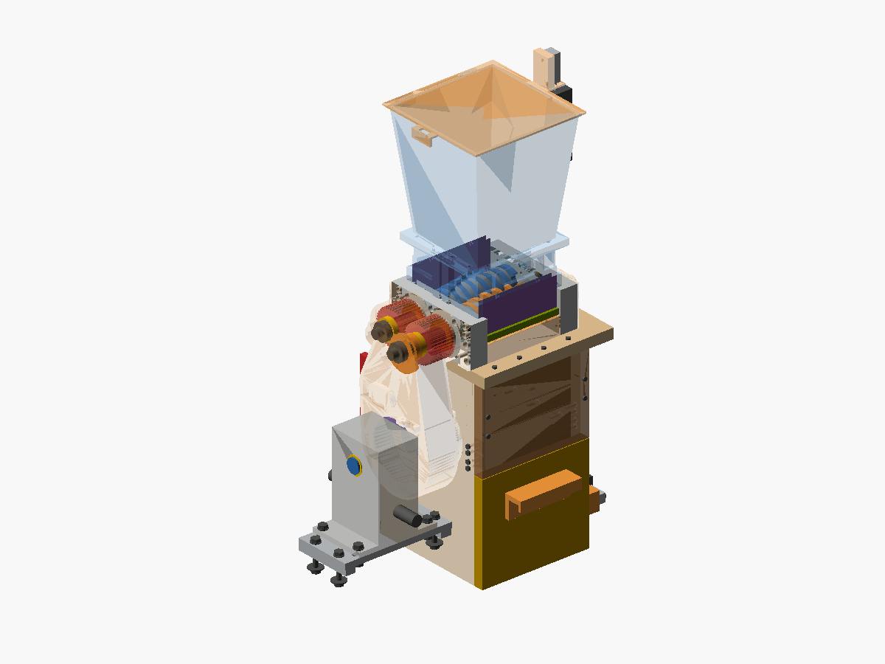
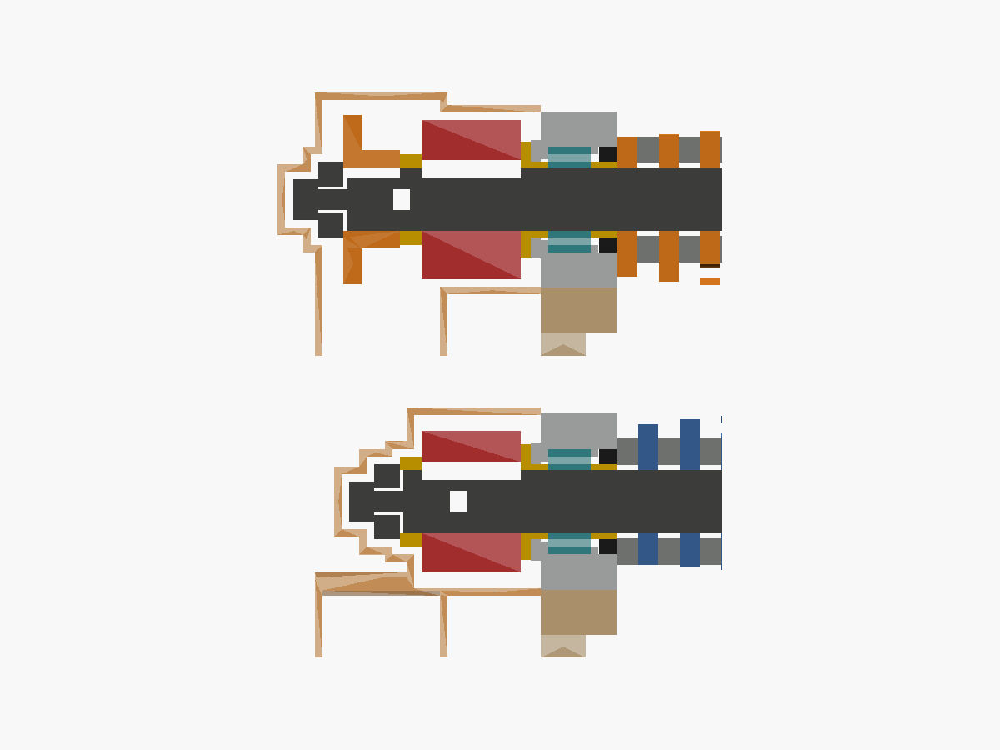
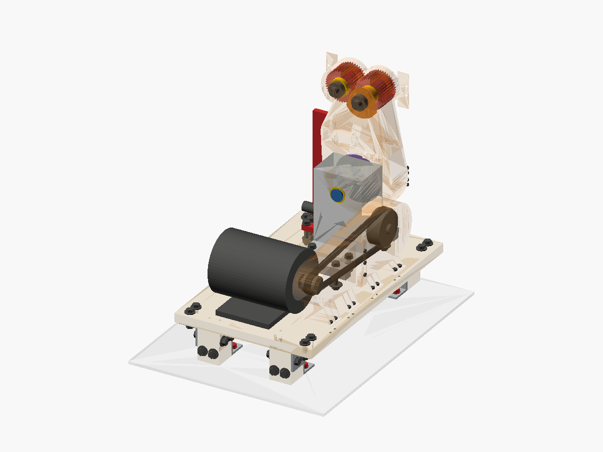

# Twin-shaft plastic shredder: design

A small, slow twin-shaft shredder for 3D-print waste (PLA, PETG, ABS/ASA, PC, nylon).
- **Made from your stock** (mild-steel flat and bar): blades, spacers, end plates, combs, walls, sleeves and the **timing gears**.
- **Made on your machines:** Roher TBL-20/520 lathe, SIEG X3.5D mill, Jingyan CNC4030, MK3S printer.
- **Bought, all from Amazon:** bearings, gearbox, torque limiter, sprockets, chain, shaft steel. (The gears are made in your shop, §5.7.)
- **Driven by** your salvaged 375 W motor.

Every number comes from [`design/params.py`](../design/params.py). The checks are in
[`docs/CALCULATIONS.md`](CALCULATIONS.md) ("CALC §n"), generated by `calc/calc.py`. The model
is the SolidCraft design [`cad/shredder_assembly.sc`](../cad/shredder_assembly.sc), built from
the parameters by [`cad/solidcraft`](../cad/solidcraft/README.md); the parts come out of it:
- STEP files in `cad/step` and STL files in `cad/stl` (for AXIS CAM and printing);
- DXF outlines in `cad/dxf`;
- pictures in `cad/png`.

The design checks (alignment, clearances, envelopes) are still the OpenSCAD ones in
[`cad/checks.scad`](../cad/checks.scad), run on the OpenSCAD sources in `cad/`.

Run `make all` after changing any parameter. It fails if any strength, fit or interference
check fails. `make variants` re-checks the fit for the parts whose sizes may differ
(sprocket hub, gear layer thickness, chain centre distance).

> **Do not connect the motor until every item in §8.4 ("Before the first power-on") is done.**

## 1. The machine in one table

| | |
|---|---|
| Type | Twin shaft, 1:1 counter-rotating, **28 rpm** |
| Blades | 16 (8 per shaft) + 2 spares. Ø68, 8 mm, 3 hooked teeth, hex bore, cut from your 70x10 flat |
| Cutting chamber | 132 x 132 mm (16 slots: 8 mm blade + 8.4 mm spacer) |
| Shafts | Bought **4140** bar 1¼" turned to Ø30: hex 25.05 AF under the blades, Ø25 journals, 60 mm apart |
| Bearings | 4 x **NA4905 needle bearings** (25x42x17), oil-sealed. Located lengthwise by an AXK3047 thrust bearing at the drive end and crinkle washers at the free end |
| Timing gears | 2 x **made** spur gear, **module 1.5, 40 teeth**, pitch Ø60, 4 laminated layers of 9.8 mm (39.2 face), bore Ø25 with the 8 mm key, **case-hardened**, backlash 0.15 mm (§5.7) |
| Drive | Your motor (1420 rpm) → V-belt 2:1 → worm gearbox NRV063, i = 50, on its feet → **TL350-2 friction torque limiter** + #40 chain, 30T → 15T, onto shaft A |
| Torque | **45 N·m** operating. The limiter is set to **55 N·m** at shaft A (110 N·m at the limiter) and can pass at most 63 N·m. A hard jam (a screw) peaks at ~107 N·m; everything is checked for it |
| Capacity | Thin-walled prints and infill. By the deliberately cautious model in CALC §2, solid sections of ~1.3 mm (PC) to ~2.1 mm (ABS) per bite; cut thicker solid lumps smaller first |
| Output | Strips ~8 mm wide. Run them through again for smaller pieces |
| Safety | Hopper lid with a **guard-locking** interlock; bin drawer with an interlock **and a fixed mesh grid** that keeps hands away from the blades; drive-end/chain guard, belt guard, side skirts, E-stop, contactor starter |

## 2. Decisions you should know about

1. **Your stock is mild steel** (S235, Sy 235 MPa). Plates, blades, spacers, combs, walls,
   sleeves and test parts are made from it.
2. **Needle bearings instead of ball bearings** (your choice, all on Amazon).
   - The shafts are only 60 mm apart, so no ball bearing bigger than a 6005 fits.
   - A jam at a stripper comb loads the drive-end bearing hardest. The 6005 limited the machine
     to ~50 N·m and had no reserve for hard jams.
   - The NA4905 is the same bore and smaller outside (42 mm). It carries **3x the load** even
     at the lowest Amazon rating (C0 20.5 kN; branded ones 30-34 kN).
   - Needle bearings carry no lengthwise load, so a thin thrust needle bearing at the drive end
     does that (CALC §7).
3. **Torque limiter after the gearbox** (your choice).
   - If something hard stops the blades instantly, the spinning worm and gearbox pulley would
     slam the shafts with an extra 50-200 N·m. A slipping belt cannot prevent that.
   - The TL350-2 friction limiter on the gearbox output slips at its setting.
   - Only the parts after it (blades, shafts, gears, chain) still have to be stopped by the
     jam: about +44 N·m (CALC §3b).
   - Its setting is checked on the bench with a lever and a weight (§6.3).
4. **The shafts are bought 4140 bar, not your mild-steel Ø30 bars.**
   - With the hard-jam peak included, mild steel misses the check at shaft A's gear keyway
     (CALC §4b-4c).
   - One 3-ft length of 1¼" 4140 makes both shafts. Turn it to Ø30 first, then machine it like
     before.
5. **The timing gears are made by you, laminated, and case-hardened** (replaces the bought m3 z20 pair).
   - The 60 mm centre distance (the blades need it) is kept: module 1.5, z = 40, from your cutter set #3.
   - Four layers of the 70x10 flat per gear (9.8 mm each): 3 layers would fail the hard-jam bending check, 4 pass (CALC §6).
   - Unhardened S235 would pit (Hertz stress 535 MPa); the teeth must be **case-hardened** after cutting (Kasenit-type powder).
   - There is no hub, so the gear is 39.2 long instead of 48 (30 + 18 hub). An **8.8 mm spacer sleeve** (Ø36, from the Ø55 bar) takes the rest, so the sprocket, chain plane, gearbox, deck and both shaft
     lengths stay exactly as they were. (Without the sleeve everything moves 8.8 mm toward the cabinet; `make variants` showed that a 20 mm sprocket hub would then put the TL350 and its guard into the cabinet.)
   - The 8 layers need **one more piece of 70x10 flat (600 mm)**: the two bars you have are used up by the blades and plates (§4.1, CALC §10).
6. **The motor's real output is probably ~250 W, not 375 W** (1.7 A at 220 V is only 374 VA in).
   - At 28 rpm it gives ~46 N·m at shaft A, so the shredder runs it near its rating.
   - It is rated **S2 30 min**: run about 30 minutes, then let it cool.
7. **Check these on the parts you receive, put the real values in `params.py`, then run
   `make all`:**
   - your gear cutter's **bore and OD** (the listing does not say; §5.7) and the **rotary table's size and ratio**;
   - sprocket hub length (22.4);
   - the TL350's sprocket (must be #40, 30T; if not, change `TL` and `CHAIN`);
   - the gearbox's real size and feet;
   - motor pulley and shaft (estimated Ø34 / Ø12).

## 3. How it works

The two shafts carry alternating blades and spacers. Each blade on one shaft runs in the gap
between two blades on the other shaft, with **0.20 mm side clearance** (nominal). The blades
overlap by 8 mm, so a tooth drags plastic down and shears off an 8 mm strip against the
neighbouring blade.

The shafts turn so their inner sides move down. The gears keep them in step. **Stripper combs**
on the outside of each shaft scrape plastic off the spacers. Consecutive blades on a shaft are
rotated 15°, so the 24 teeth on each shaft bite one after another.

Coordinates used everywhere:
- x runs along the shafts, from x = 0 at the inside face of the drive-end plate to
  x = 132.2 at the free-end plate;
- shaft A, driven by the chain, is at y = −30; shaft B is at y = +30;
- z points up, with the shaft centres at z = 0.

**What sits on each shaft at the drive end, going outward from the chamber:**
1. clamp sleeve (Ø30, runs in the oil seal);
2. NA4905 inner ring;
3. collared sleeve, whose collar presses the thrust bearing against the plate;
4. gear (4 laminated layers, keyed, no hub) and the 8.8 mm **gear spacer sleeve**;
5. on shaft A only, the 15T sprocket;
6. end cap and M10 screw.

**At the free end:**
1. clamp sleeve;
2. inner ring;
3. collared sleeve, with crinkle washers and a thrust bearing between its collar and the plate;
4. end cap and screw.

Everything on a shaft is clamped between its two end caps (CALC §8).

## 4. Parts

### 4.1 Made by you

| # | Part | Qty | From | Machine | Key dimensions |
|---|---|---|---|---|---|
| 1 | Blade (phase variants v0-v3) | 16 + 2 | 70x10 flat | SIEG (face), CNC | Ø68, **8.00 ±0.02**, hex bore **25.10 AF fitted to the shaft** (25.08-25.13), Ø3.2 corner reliefs |
| 2 | Spacer | 15 | Ø55 bar | Lathe | OD 50, bore 29.2, thickness from the **stack schedule** (nominal 8.40) |
| 3 | End spacer (shaft B, drive end) | 1 | Ø55 bar | Lathe | as 2, nominal 8.20 |
| 4 | Shaft A | 1 | bought 4140 bar | Lathe, SIEG | 277.6 long; journals Ø25 h6, hex, 2 keyways (gear, sprocket); CALC §11 |
| 5 | Shaft B | 1 | bought 4140 bar | Lathe, SIEG | 255.2 long; 1 keyway (gear); CALC §11 |
| 6 | Inner plate layer | 2 | 70x10 flat | SIEG | 170 x 70; **Ø42 x 7 seal bore** from the chamber side, then **Ø36** (bearing shoulder) |
| 7 | Outer plate layer | 2 | 70x10 flat | SIEG + boring head | **Ø42 H7** through, the two bores **60.00** apart |
| 8 | Cap layer | 2 | 70x10 flat | SIEG + boring head | **Ø42 H7 x 7 deep** from the inner face, then Ø32 through |
| 9 | Drive clamp sleeve | 2 | Ø55 bar | Lathe | **OD 30 smooth (seal surface)**, ID 25.05, made **10.60**, faced to fit (nominal 10.50, §7.3) |
| 10 | Free clamp sleeve | 2 | Ø55 bar | Lathe | OD 30 smooth, ID 25.05, 10.50 (A), 10.70 (B) |
| 11 | Collared sleeve, drive | 2 | Ø55 bar | Lathe | ID 25.05, body Ø30 x 7, collar Ø46 x 4 |
| 12 | Collared sleeve, free | 2 | Ø55 bar | Lathe | ID 25.05, body Ø30 x 9, collar Ø46 x 4 |
| 13 | End cap | 4 | Ø30 bar | Lathe | Ø30 x **10**, hole Ø10.5 |
| 14 | Stripper comb | 2 | 50x10 flat | CNC | 132.2 x 25 x 10, slots 9.0 wide |
| 15 | Wall | 2 | 50x10 flat | SIEG | 132.2 x 50 x 10 |
| 16 | Gearbox output shaft | 1 | **bought 4140 bar** | Lathe, SIEG | Ø25 h6 through the gearbox's hollow output; keyway for the gearbox AND for the TL350; circlip groove on the far side; `cad/stl`, CALC §3a |
| 16b | Gearbox rails | 2 | 50x10 flat | SIEG | slotted ±6 mm along the shafts (axial chain alignment), bolted through the deck into the leg frame |
| 16c | Bin grid frame | 1 | timber cleats + bought mesh | saw | holds the 1" mesh grid across the whole cabinet, ≥ 120 mm below the blade tips (§8.1) |
| 17 | Sprocket rework | 1 | bought 15T sprocket | Lathe + broach | re-bore Ø25 H7, broach an **8 mm** keyway |
| 18 | TL setting stub + chain-whip lever | 1 + 1 | Ø30 bar, 50x10 flat | Lathe, SIEG | `cad/tlfix.scad` (§6.3) |
| 19 | Blade torque test lever | 1 | 50x10 flat + Ø12 hardened pin | SIEG | `cad/testlever.scad` (§5.6) |
| 20 | Stacking mandrel | 1 | Ø30 bar | Lathe | Ø24.9 x 150 (§7.1) |
| 11b | Gear spacer sleeve | 2 | Ø55 bar | Lathe | **OD 36**, ID 25.05, **8.80** (= 48 − 4 x 9.80, faced to the gears' actual length), ends flat and square: it is part of the clamp chain; `cad/stl/gear_spacer.stl` |
| 20b | **Gear** (A and B identical) | 2 x 4 layers = 8 layers | 70x10 flat (extra piece, §4.2) | SIEG (face), CNC, lathe, SIEG + rotary table | module 1.5, z 40, OD 63.0, cut depth 3.475, face 4 x 9.80, bore Ø25 H7, keyway 8 JS9; `cad/stl/gear_A.stl`, `cad/dxf/gear_layer.dxf`; §5.7 |
| 20c | **Gear mandrel** (+ washer Ø30 x 6) | 1 | Ø30 bar | Lathe, SIEG | grip Ø30 x 45, Ø25 g6 seat x 42 with an 8 mm keyway, M16 x 1.5 x 24 stud; `cad/stl/gear_mandrel.stl`; §5.7 |
| 21 | Printed parts | | PETG | MK3S | hopper (collar, funnel, lid + pads), side skirts, drive-end/chain guard, free-end cover, belt guard, drawer handle (`cad/stl`) |
| 22 | Plywood | | 18 mm ply + 45x45 timber | saw / router | base plate, bin cabinet (2 sides, back, floor, **fixed upper front panel** 192.2 x 142), drawer (**short front** 192.2 x 172, bin), drive deck + legs (`cad/dxf`) |
| 23 | Chain tensioner | 1 | as drawn in `cad/` | | keeps the slack side of the chain taut |

The cut list is in CALC §10. **Cut the plate layers and blade strips from the 70x10 flats first,
exactly to plan**: there are only 20 and 34 mm to spare, so **the 8 gear layers need an extra piece
of 70x10 flat** (~584 mm with the cutter slots; buy 600).

### 4.2 To buy (Amazon)

| Item | Qty | Amazon (example listing) |
|---|---|---|
| 4140 alloy steel round rod **1¼" x 3 ft**, cold-worked annealed | 1 | [B09Q3NW324](https://www.amazon.com/Alloy-Steel-Round-Diameter-Length/dp/B09Q3NW324) |
| **NA4905** needle roller bearing with inner ring, 25x42x17 | 4 (+1) | [NMD B0CD14LTPC](https://www.amazon.com/NMD-NA4905-Bearing-Inner-25X42X17/dp/B0CD14LTPC) or [B0F5HJ3RQF](https://www.amazon.com/NA4905-25x42x17-4544905-Bearing-machined/dp/B0F5HJ3RQF) |
| **AXK3047 + 2 x AS3047** thrust needle bearing set | **4** (one per shaft end) | [B0C6DVPHCF](https://www.amazon.com/TMP1105-AXK3047-Bearing-Bearings-30x47x4mm/dp/B0C6DVPHCF) |
| Oil seal **TC 30x42x7** | 4 | [EAI B07YGT7LD9](https://www.amazon.com/30X42X7-EAI-Spring-Coating-30mmX42mmX7mm/dp/B07YGT7LD9) |
| Crinkle washer 30x39x0.5 | 6 | [uxcell B01E0CSZIM](https://www.amazon.com/clp/B01E0CSZIM) |
| **Flat bar 70 x 10 mild steel, 600 mm** (for the 8 gear layers; the same stock as your flats) | 1 piece | **a local metal shop** (raw steel is the one exception to the Amazon-only rule: no 70 mm flat on Amazon ships to Israel) |
| **Kasenit-type case-hardening powder** (the same product is optional for the blades, §9) | 1 tin (a small one is enough) | [search "Kasenit" / "case hardening compound"]; **now required for the gears** |
| **M16 x 1.5 nut** (+ spare) for the gear mandrel | 2 | any hardware shop |
| **Worm gearbox NRV063-VS, i = 50**, Ø19 input shaft, Ø25 hollow output | 1 | [B0F18S6XS5](https://www.amazon.com/Reducer-NRV063-VS-Double-Output-Gearbox/dp/B0F18S6XS5) (choose 50:1) |
| **TL350-2 friction torque limiter** with #40 30T sprocket, bore 25 + keyway | 1 | [B0GJ689QR6](https://www.amazon.com/Overload-Protection-Industrial-Machinery-Transmission/dp/B0GJ689QR6) (confirm the sprocket and bore with the seller) |
| **#40 sprocket, 15 teeth, B-hub**, smallest bore (¾") | 1 | [Saelno B0DG561DLL](https://www.amazon.com/Saelno-Sprocket-Hardened-Sprockets-40B15-3/dp/B0DG561DLL) |
| #40 roller chain + connecting link | length per `cad/` | any #40 chain |
| #40 **idler sprocket** 15T with bearing (for the tensioner) | 1 | any "#40 idler sprocket 15T" with a bearing and a 10-12 mm bore |
| Metric keyway broach set (8 mm broach, 25 mm bushing) | 1 | [B0BRV75RNS](https://www.amazon.com/Lidhujnk-Metric-Collared-Bushing-Processing/dp/B0BRV75RNS) |
| V-belt pulley for the Ø19 gearbox input (2x the motor pulley), V-belt | 1 + 1 | match your motor pulley's section |
| Keys 8x7 (bar, **chamfer the top edges 1.5 x 45°**, §5.7), M10 x 30 socket screws (4), M6/M5/M4 screws, dowel pins Ø6 | | |
| **Lid: Pizzato FS 3096D024-F7** guard-locking switch: locked with the solenoid **de-energised** (power to unlock), 24 V, comes with its adjustable jointed actuator | 1 | [B07HCCFTQB](https://www.amazon.com/dp/B07HCCFTQB). Not the "E" version: that one unlocks when the power fails |
| **Drawer: Omron D4NS-2AF** safety door switch + **D4DS-K2** key | 1 + 1 | D4NS-2AF on Amazon; key [B00DK2CU2Q](https://www.amazon.com/OMRON-D4DS-K2-SAFETY-INTERLOCK-SWITCH/dp/B00DK2CU2Q) |
| **Welded wire mesh 1" x 1", 14 ga galvanized** (cut a piece for the bin grid) | 1 roll | [YardGard B0009EU2M8](https://www.amazon.com/clp/B0009EU2M8) |
| Floor/bench anchors M8 (8), steel angles 40x40x4 (4 for legs + 4 for feet) | | the drive deck is held down against the chain's uplift (CALC §3a) |
| Contactor + thermal overload (~1.9 A), START/STOP, mushroom E-stop, 24 V DC supply, on-delay timer relay | | §8.2 |

All of these were found on Amazon (Nov 2026). Check that each listing ships to Israel before
ordering.

## 5. Making the parts

### 5.0 Tolerances that matter (everything else ±0.1)

| Feature | Tolerance | Why |
|---|---|---|
| Blade thickness | 8.00 ±0.02, flat | side clearance |
| **Blade face positions in each stack** | ±0.03 from the schedule (§7.1) | errors must not accumulate |
| Bearing seats Ø42 (outer layers + caps) | H7 (42.000-42.025); bore each end's outer layer and cap together, the two ends doweled | bearing fit and alignment |
| Bearing-seat centre distance | 60.00 ±0.02 | gear mesh (backlash 0.15 only) |
| Gear tooth depth | 3.475 ±0.03 | backlash (CALC §6: worst case 0.03 mm left) |
| Gear layer thickness | 9.80 ±0.02, flat | the 4 layers must make 39.2 ±0.1 |
| Journals Ø25 | h6; an NA4905 inner ring should *slide* on | assembly |
| Clamp sleeve OD 30 | h8, Ra ≤ 0.8 (turn fine, polish) | oil seal lip |
| Hex across flats | 25.05 ±0.03 | blade fit |

### 5.1 Blades: SIEG, then CNC4030
1. Saw the 70x10 flats per CALC §10:
   - from the 1300: two 380 mm strips (5 blades each) and three 170 mm plate layers;
   - from the 1170: two 308 mm strips (4 blades each) and three layers.

   **Face both sides of every strip to 8.00** on the SIEG.
2. **Hold-down.** Blade centres are 72 mm apart, 46 mm from each strip end. Drill:
   - **Ø5.5 at each blade centre**, for an **M5 socket screw with a Ø10 washer** that holds the
     bore slug;
   - **Ø5.5 at every gap between blades**, at y = ±29;
   - two holes at each end, 6 mm in, at y = ±29.

   Screw the strip to an MDF or aluminium sub-plate with **M5 socket heads (Ø8.5)**. Use a tool
   stickout of ≥ 16 mm so the collet nut clears the heads (CALC §9).
3. **Test cut first,** on a 50x10 offcut: a 40 mm full-depth slot and one hex bore with its
   reliefs. If it chatters or the slot measures over 6.4, use ae 0.2 and 300 mm/min.
4. **Toolpaths in AXIS CAM** from `cad/stl/blade_vN.stl`, material **Mild steel 1018**:
   - tools: **Ø6 carbide 3-flute (AlTiN)**, and **Ø3 carbide** for the corner reliefs;
   - 7500 rpm, adaptive, ae 0.3, 400 mm/min, 2 depth levels of 4 mm;
   - finish pass 0.1;
   - ramp entries ≤ 2°. Never plunge the Ø6.

   Order per blade:
   1. six Ø3 corner reliefs, 8.2 deep;
   2. the hex bore with the Ø6, leaving 0.1;
   3. try the real shaft in the bore and set the finish so the blade **slides on by hand
      without rocking (25.08-25.13 AF)**;
   4. the outer profile, with 3 tabs (4 wide, 1.5 high) on the backs of the teeth.

   About 50 minutes per blade.
5. **Mark each blade.** Make 4 of each variant v0-v3, plus 2 spares. Spot-mark the bore corner
   that is v x 15° from the tooth tip, and stamp the variant number and a "T" on the top face.
6. Break the tabs flush and deburr the faces lightly. Keep the edges sharp. **Write the
   thickness on every blade.**

### 5.2 Spacers, sleeves, end caps: lathe
1. **Spacers** from the Ø55 bar: OD 50, bore 29.2. Part them off at ~8.8 and finish the second
   face on a Ø29.2 stub mandrel (parallel within 0.01); final thickness comes from §7.1.
2. **Clamp sleeves**: OD 30 h8, **turned fine and polished**, because the oil seals run on them.
   ID 25.05. Drive sleeves 10.60; free sleeves 10.50 (A) and 10.70 (B).
3. **Gear spacer sleeves** (2): OD 36, ID 25.05, **8.80** long, from the Ø55 bar; face both ends flat and square. Make them last, from the measured length of the finished gears: 48.0 − gear length.
3b. **Collared sleeves**: ID 25.05, body Ø30 (h8; it passes through the thrust bearing and the
   cap hole), collar Ø46 x 4. The collar faces must be flat and square: they carry the thrust
   bearing.
   - drive: body 7, total 11;
   - free: body 9, total 13.
4. **End caps** Ø30 x 10, hole Ø10.5, from your Ø30 bar.

### 5.3 Shafts: bought 4140, lathe then SIEG
1. Saw the 4140 bar into shaft A (≥ 281) and shaft B (≥ 259). Turn them to Ø30, face to length
   (CALC §11) and centre-drill.
2. Between the chuck and the centre, turn all journals **Ø25 h6**. Leave Ø30 only for the hex.
   Gauge with an NA4905 inner ring: it must slide on.
3. Both ends: drill Ø8.5 x 30 and tap M10 x 25.
4. **Hex on the SIEG** with a 5C hex collet block: a Ø16 end mill to 12.525 from the axis on
   each of the 6 flats, opposite flats checked at 25.05. Punch **corner 0**.
5. **Keyways** 8 JS9 x 4, on the corner-0 side, per CALC §11: the gear seat on both shafts and
   the sprocket seat on A.
6. Annealed 4140 machines like a tough medium-carbon steel. Use sharp carbide and coolant.

### 5.4 End plates: SIEG
1. **Clamp all six layers together.** Square the edges, then drill through all six:
   - Ø10 pilots at the shaft centres (y = ±30, z = 0);
   - the dowel holes at (±55, −27), reamed Ø6.
2. **Bore Ø42 H7** with the boring head, 60.00 apart by the DRO:
   - **outer layer + cap of each end clamped together** on the dowels;
   - the outer layer through, the cap **7 deep** from its inner face;
   - then the cap's Ø32 through.
3. **Inner layers:** Ø42 x 7 deep from the chamber face (seal bore), then Ø36 through.
4. Then the other holes per `cad/plate.scad`: joining, comb, wall and guard holes, hopper top
   holes, feet. Joining screws are **M6 x 20**.

### 5.5 Combs, walls, printed and wooden parts
- **Combs:** CNC, 8 slots 9.0 wide running 3 mm past the blade tips; M6 tapped in the ends, M4
  underneath.
- **Walls:** plain bars, M5 tapped in the ends and edges.
- **Printed (PETG, 4 perimeters, 40 %):** the parts in row 21.
- **Plywood:** row 22, from `cad/dxf/`.

### 5.6 Blade torque test (first finished blade, before making the rest)
This proves the mild-steel hex bore takes the torque. Its edges bed in slightly on first load
(CALC §5).
1. Clamp a shaft by two hex flats (soft jaws). Put one blade on the hex next to the journal.
2. The **test lever** pivots on the journal. Its **Ø12 hardened pin** sits on a tooth's hook
   face, with the lever horizontal and turned against the cutting direction
   (`cad/png/blade_torque_test.png`).
3. Measure the play at a tooth tip with a dial indicator.
4. Hang **11.9 kg at the 500 mm hole** for 10 seconds, 10 times. The lever's own weight adds
   about 5 N·m, for 63 N·m, the most the limiter can pass.
5. **Accept if the play grew ≤ 0.05 mm.** Otherwise make the bore fit tighter before making
   the other blades.

### 5.7 The gears: laminated, cut on the mill, case-hardened
You own the **module 1.5, 20°, HSS, #1-#8 gear cutter set** (Amazon B09TB7FPFF), the **MT3 slitting-saw arbor** with 1/2", 5/8", 3/4", 7/8", 1" seats and an M12 drawbar
(B07D4CS64X), a **rotary table** and the SIEG X3.5D. Both gears are identical: **module 1.5, z = 40, pitch Ø60, outside Ø63.0, root Ø56.05**, cut with cutter **#3**
(it covers 35-54 teeth), 9° per tooth. Everything below comes from CALC §6 and §9b; the model is `cad/gear.scad`.

**Why four layers, why hardened.**
- Only the 70x10 flat is wide enough for a Ø64 blank, and it is 10 thick. 4 x 9.8 = 39.2 mm of face: at the hard-jam peak the Lewis stress is ~166 MPa on yield 235
  (SF 1.4 ≥ 1.2); 3 layers would give 1.06 and fail.
- Unhardened S235 would see 535 MPa Hertz stress at the operating torque and pit. **The teeth must be case-hardened** (step 9); the check assumes a thin pack-carburised case
  (σH,lim 1000 MPa, SF 1.9). If you cannot case-harden, do not use these gears.

**Backlash is made by cutting 0.10 deeper** (depth 3.475, not the standard 3.375) **on both gears**: each tooth is 0.073 mm thinner at the pitch circle, the pair has
**0.146 mm** of backlash (CALC §6). Do not cut deeper than 3.50, and keep the bearing seats at 60.00 ±0.02.

**Tools and fixtures**
- **Gear mandrel** (part 20c, from your Ø30 bar, drawing `cad/stl/gear_mandrel.stl`):
  - Ø30 grip x 45 with a square shoulder;
  - **Ø25 g6 seat, 42 long** (4 layers = 39.2 + 2.8) with an **8 mm keyway 4 deep, 40 long**, closed at both ends;
  - **M16 x 1.5 stud, 24 long**, centre-drilled at the end (the lathe has a tailstock);
  - a **washer Ø30 x 6** (from the same bar) and an M16 nut clamp the layers.
- A **key 8 x 7 x 35** with the top two edges chamfered 1.5 x 45° (it is also the final key of the gear). The keyway in each layer is cut with a Ø3 end mill, so its bottom corners are R1.5; a sharp key
  would sit on the corner and not seat.
- **Cutter bore.** The listing does not give it. **Measure it first** (and its OD and thickness). Each seat of the arbor is a different diameter (1/2", 5/8", 3/4", 7/8", 1") and the cutter goes on the
  seat that equals its bore. A common bore for module 1.5 sets is **22 mm**: it is smaller than the 7/8" seat (22.225), so it does **not** fit it, and bigger than the 3/4" seat (19.05).
  Then turn a **bushing from the Ø30 bar: bore 19.05 (slides on the 3/4" seat), OD 22.00 (the cutter slides on it)**, with the cutter's key slot in mind if it has one. If the bore is 22.225 use
  the 7/8" seat directly, if 25.4 the 1" seat, if 19.05 the 3/4" seat. Clamp the cutter and its spacers with the arbor's nut; the M12 drawbar holds the arbor in the MT3 spindle.

**Steps**
1. **Face 8 layers** from the 70x10 flat on the SIEG, both sides, to **9.80 ±0.02**, flat. (From the extra 600 mm piece, §4.2.) Number them 1-8 with a punch on the edge.
2. **CNC the layers** (`cad/dxf/gear_layer.dxf`, same hold-down and tools as the blades, §5.1): outline **Ø64 rough**, **bore Ø25 H7** (finish to the real shaft: a hand slide fit with no rocking on a
   Ø25 h6 offcut, 25.00-25.04), **keyway 8 JS9** with the Ø3 end mill (R1.5 corners). Mark the keyway side and the top face of every layer; **keep the four layers of one gear in order**.
   About an hour per layer.
3. **Turn the mandrel** (Ø25 g6 seat, key slot milled on the SIEG, M16 thread).
4. **Stack 4 layers on the mandrel** with the key in, in the marked order and orientation, washer and nut tight. Check the faces are flat on each other (no burrs: file them).
5. **Turn the OD to Ø63.0** on the lathe, mandrel between the chuck and a centre. Take light cuts, finish at **63.00 -0.03**. The Ø64 → Ø63 cut also removes the CNC outline's burr.
6. **Mount the mandrel on the rotary table, standing VERTICAL** (the table's axis along the X travel) on the X3.5D. Hold the mandrel by its Ø30 grip in a chuck on the table, or on a
   faceplate or through the table's centre bore, whichever your table allows (size unknown, open item 3). **Keep the gears close to the chuck**; there is no tailstock, so use light passes.
7. **Set up the cutter:** #3 on the arbor in the spindle (the arbor held by the M12 drawbar). The cutter's mid-plane must pass through the gear axis. Method: touch the cutter's lower face
   on the top of the Ø30 shoulder (a feeler or a paper strip), raise the head and then lower it by **15 + half the cutter thickness** to centre it on the axis; check with a trial notch on the shoulder.
   Touch off the **OD** with the cutter side on the Ø63 (paper under it), zero the cross DRO.
8. **Cut the teeth:** 3 passes to a total depth of **3.475** (1.2 / 1.2 / 1.075 mm, the last one light), cutting oil. **HSS form cutter, mild steel: 20-25 m/min**, so
   **n = 1000·Vc/(π·D)**: for a Ø50 cutter 127-159 rpm (CALC §9b table; measure your cutter's OD and take the speed your mill has just below). The brief's 60-80 m/min is too fast for a form cutter;
   60-80 *ft*/min is what catalogues give (18-24 m/min). Feed ~25-50 mm/min.
   **Index 9° per tooth** = **handwheel turns = table ratio / 40**: 90:1 → **2 1/4 turns** per tooth (2 turns + 90° of the handwheel's scale), 80:1 → 2, 72:1 → 1.8, 60:1 → 1.5,
   40:1 → 1. Count the ratio first (turn the handwheel until the table has made one turn). For each tooth: index, lock the table, cut all the way along the face. After 10 teeth check the angle (a dial indicator on a flank); the 40th tooth must meet the first.
   Cut all 4 layers of gear A, then gear B the same way. **For B, start the indexing half a tooth later (4.5° = R/80 handwheel turns: 1 1/8 on a 90:1)** from the keyway, so that with the keyways in line
   (the CAD) the teeth mesh; or cut both identically and, when fitting, turn shaft B until its gear meshes before its key goes in (the blades of A and B run in different slots, so their relative angle does not matter).
9. **Deburr, then case-harden** each layer (loose, not stacked): pack in Kasenit-type powder in a steel box or tin, soak at bright red (~900 °C) for **1-2 hours** for a case of a few tenths of a mm
   (we need ≥ 0.3 mm), quench as the powder's instruction says, temper at ~180 °C for an hour. **Plug the bore and keyway** with a steel plug and powder-free fire-clay if you do not want them to carburise;
   either way, afterwards **check the fit on the shaft offcut and the key**: lap the bore with fine emery on a split rod if it went tight (distortion is typically 0.02-0.05). The 0.15 mm backlash has room for it.
10. **Fit the gears:** teeth are not touched any more; grease, key, teeth first, keyway toward the shaft's keyway (§6.2). Both gears have **no hub**: the gear is 39.2 long and the **8.8 mm spacer sleeve** (part 11b) follows it, so everything outboard sits where the bought 48 mm gear put it. Face the sleeve to (48.0 − the measured total of your 4 layers).

## 6. The drive

### 6.1 Layout (`cad/png/drive_iso.png`)
- The **gearbox stands on its feet** on the drive deck, below the drive end of the shredder,
  outside the bin cabinet.
- **Gearbox output shaft** (part 16, 4140): it runs through the gearbox's Ø25 hollow output on its
  key, held by a circlip on the far side. On the chain side the **TL350-2** sits **flange-first
  against the housing** (3 mm gap), keyed, with a stop collar outboard. The TL's sprocket is inside
  its friction pack, so the chain is only ~15 mm from the housing. Check that your gearbox allows
  ≥ 2.2 kN radial load on its output (catalogue value FR2, CALC §3a).
- The gearbox stands on **two slotted rails** (part 16b). The slots let it slide along the shafts,
  so the two sprockets can be put in one plane.
- **Bolt the deck down.** The chain pulls the gearbox UP with up to ~2.2 kN, so standing it
  there is not enough. Fix each leg to the deck with a steel angle and 2 x M8, and each leg's
  foot angle to the floor or bench with 2 x M8 anchors or lag screws (≥ 2 kN pull-out each).
- The **#40 chain** runs from the TL's 30T sprocket up to the 15T sprocket on shaft A. That's a
  2:1 speed-up, so the shredder turns at 28 rpm.
- A **tensioner** (an idler sprocket in a slotted upright) keeps the slack side taut.
- **Chain centre distance: 150-157 mm** (TL axis to shaft A).
  - Shorter brings the chain into shaft B's end screw.
  - Longer would need the deck below the floor.
  - Set it with shims under the gearbox feet.
- The **unused end of the gearbox's double input shaft** must not spin exposed. Saw it off flush
  with the housing and deburr it, or fit a cover bolted to the housing.
- The **motor** stands on the deck with its slotted foot, for belt tension. The V-belt runs to
  the gearbox's Ø19 input shaft.
- **Fit the real parts:** put the measured gearbox, pulley, gear layer thickness and sprocket-hub sizes and
  the chain centre distance into `params.py`. Run `make all` and `make variants`, and use the
  regenerated deck and guard drawings.

### 6.2 Fitting the sprocket and gears
- The gears are the ones you made (§5.7): bored Ø25, keyway 8, no hub. Fit them **with the layer you marked "1" toward the plate**, keyed, with the key's chamfered edges in the gear, then the spacer sleeve (plain Ø25 bore, no key).
- Mesh shaft B's gear with A's before its key goes in (or use the half-tooth indexing of §5.7 step 8). Any angle is fine.
- **Sprocket:**
  1. Bore it to Ø25 H7 on the lathe, gripping on the hub and indicating the teeth true.
  2. Broach the 8 mm keyway with the broach set and the 25 mm bushing, pressing in the vise or
     a press.
  3. Fit it on shaft A outboard of the gear's spacer sleeve.
- Line the chain up: slide the gearbox along its rail slots until both sprockets are in one plane
  within 0.5 mm (a straight edge across both). Use shims under the gearbox feet only for the
  centre distance (150-157 mm).

### 6.3 Setting the torque limiter (bench, before fitting it)
The TL350-2 slips when its friction discs are overcome. Its adjusting nut sets that torque.
1. Put the TL on the **setting stub** (part 18) clamped in the vise, keyed like the gearbox
   shaft (`cad/png/tl_setting.png`).
2. The **lever pivots on the stub's Ø25 pin** beyond the TL's adjusting nut. The **chain whip**
   (33 links of #40 chain) wraps the TL's sprocket, and both ends bolt to the lever's lugs near
   the pivot.
3. Hang **21.1 kg at the 500 mm hole**. Weigh it on a bathroom scale first, e.g. a filled water
   can. With the lever's own 6.6 N·m (the lever horizontal) that is **110 N·m at the limiter =
   55 N·m at shaft A**.
4. Tighten the adjusting nut until the sprocket **just stops slipping** with the lever horizontal.
   Lift the weight and lower it gently 3 times: it must hold. With 2 kg more it must slip slowly.
5. Lock the nut as the TL instructions say. Run a few slips by hand to bed the discs in, then
   check again.
6. Re-check after the first hour of use and every few months.

The limiter is checked to pass at most 63 N·m (+15 % friction scatter) to shaft A quasi-statically,
and ~107 N·m for an instant at a hard jam (CALC §3b). The gearbox never sees more than the
limiter's setting.

## 7. Assembly

### 7.1 Stack schedule: make the spacers to fit the blades
The blades of A and B pass with 0.20 mm side clearance, so errors must not add up:
1. Stand the **stacking mandrel** (Ø24.9) on a flat surface.
2. Start the stack with blade 0 (shaft A) or the end spacer (shaft B).
3. After each part, measure the height of its top face with the dial caliper's depth rod, at 3
   places, against the schedule (CALC §8).
4. Face the **next** spacer so the following blade lands within **±0.03**: spacer =
   (scheduled top of the next blade − that blade's thickness) − current height.
5. Number the spacers and keep each stack in order.

### 7.2 Order of assembly
1. **End plates.**
   - Press the oil seals into the inner layers, lip toward the chamber.
   - Press an NA4905 *outer ring with its needles* into the outer layer of each end.
   - Assemble inner + outer + cap on the dowels with M6 x 20. The outer ring is clamped between
     the inner-layer shoulder and the cap step.
2. **Load each shaft.**
   - From the **drive end**: drive clamp sleeve (10.60), then an NA4905 **inner ring**. They
     stop at the hex.
   - From the **free end**: the stack in order:
     - A: blade 0, spacer ... spacer;
     - B: end spacer, blade 0 ... blade 7.
   - Blade orientation:
     - B: stamped face toward the free end;
     - A: stamped face toward the drive end;
     - blades 0-3 on corner 0, blades 4-7 one corner earlier against the rotation.
   - Then the free clamp sleeve and the free inner ring.
3. **Insert both shafts** into the drive-end plate from the chamber side. The clamp sleeves
   pass the seals (oil the lips) and the inner rings slide into the needles.
4. **Drive end, outboard:**
   - on the cap face: an AS3047 washer, the AXK3047 cage and a second AS3047 washer;
   - the drive collared sleeve, collar outward;
   - the gear (4 layers, marked order), keyed, then its spacer sleeve;
   - on A: the sprocket, keyed;
   - end cap and M10 x 30.
5. **Combs and walls** onto the drive-end plate.
6. **Free-end plate** over both shafts at once: seals oiled, inner rings into the needles.
   Bolt the combs and walls.
7. **Free end, outboard:**
   - on the cap face: 3 crinkle washers, AS3047, AXK3047, AS3047;
   - the free collared sleeve, collar outward;
   - end cap and M10 x 30.
8. **Clamp:** tighten all four M10 to **~8 N·m** (4 kN). The end caps never touch the shaft
   ends (1.5 mm clearance, CALC §8). The crinkle washers now push both shafts toward the free
   end, so their drive-end collars sit firmly on the drive thrust bearings.

### 7.3 Align the two stacks (feeler gauges)
1. Turn the gears by hand. At both ends and the middle, check the gaps on both sides of a B
   blade between its A neighbours:
   - 0.10 must pass on both sides;
   - the two sides should match within 0.05.
2. If one side is tight everywhere, the stack is offset. Face that shaft's **drive clamp
   sleeve** shorter by the offset (down to no less than 10.40) and re-clamp.
3. If it is tight in one place only, redo that spacer.
4. A full turn by hand must be free. Grease the gears, fit the chain and tensioner, then the
   guards.

## 8. Safety

### 8.1 Guards (all in `cad/`)
- **Hopper.** It continues the chamber walls 250 mm up to a lid. The lid has a **guard-locking
  interlock** (Pizzato FS 3096D024-F7).
  - It stays locked while the motor runs, and until the blades have stopped (§8.2).
  - Load with the lid open and the motor stopped, close the lid, press START. Push material with
    a stick only.
- **Outlet.** A closed cabinet with a drawer bin. Neither front panel has an opening.
  - **The front is two panels.**
    - A **fixed upper front panel** (18 mm ply, z = −195 … −53) closes the front of the cabinet
      from the underside of the base plate down to 1 mm below the lower grid cleats (−193.9). It is
      screwed on, so it needs a tool to remove: 4 x M4 x 45 from the top of the base plate into its
      top edge (Ø5 holes in the base, Ø3.3 x 25 pilots) and 4 x M4 x 45 through its face into the
      front edges of the two side panels.
    - The **drawer front** is only 172 mm tall (z = −368 … −196, 1 mm under the fixed panel). It
      covers the bin and carries the handle and the interlock key.
    - **With the drawer pulled out or removed, the opening is only below the grid.** Nothing above
      the mesh is open to the outside, so a hand cannot go in over the mesh.
  - **The protection from below is a fixed grid,** not the drawer switch. A piece of 1" x 1"
    welded mesh (14 ga) spans the whole inside of the cabinet, **at least 120 mm below the lowest
    blade tip**. The CAD puts its top at z = −170, 136 mm under the tips.
    - It sits between two layers of 20 x 20 timber cleats. The cleats under it and the ones on
      top are fastened with M4 x 35 wood screws driven from outside the plywood.
    - The front cleats are rails that run across the cabinet, behind the fixed front panel. They
      are screwed through the side panels at their ends and stand 1 mm clear of the fixed panel.
    - The mesh is cut to leave 0.5–10 mm at every wall.
    - The drawer bin is 150 mm tall, so its top stays 4 mm under the lower cleats.
  - Per ISO 13857 (Table 4), square openings up to 30 mm need ≥ 120 mm between the opening and
    the hazard, so even with the drawer pulled out no finger can reach a blade. The 8 mm shreds
    fall through it.
  - The drawer's switch (Omron D4NS) stops the motor when the drawer is pulled, so you don't run
    the machine without a bin. The switch pad is on the free-end side panel and its key pad on
    the end of the drawer front, both at z = −300 (inside the short drawer front).
  - Side skirts close the gaps under the combs.
- **Drive-end and chain guard** encloses the gears, sprocket, end caps, chain, tensioner and
  limiter. The **free-end cover** goes over the rotating end caps, and the **belt guard** over the
  belt and pulleys.

### 8.2 Wiring
Mains → fuse → **contactor starter** with a thermal overload (~1.9 A) → motor.
- **Contactor coil circuit, in series:** E-stop (NC) → lid switch safety contacts → drawer switch
  (NC) → STOP (NC) → START (NO, self-holding).
  - Use the lid switch's contacts that are closed only when the lid is **closed and locked**,
    and the drawer switch's positive-opening NC contact.
  - A power cut stops the motor, and it stays stopped until START (no-volt release).
- **Lid unlocking.**
  - The FS 3096D024 is locked with no power. Its 24 V solenoid unlocks it.
  - Power the solenoid through an **on-delay timer relay**. The relay starts timing when the
    contactor drops out, and it closes only after the contactor has been off for **T_unlock**.
  - Set T_unlock = **max(1.0 s, 2 x the measured stopping time)** (§8.4).
  - An UNLOCK push-button in series lets you unlock on purpose. The switch's own release is for
    clearing jams with the power off.
- Earth the steel frame and the motor. If you are not qualified for mains wiring, have an
  electrician do it.

### 8.3 Use
- Run at most 30 minutes, then let the motor cool (S2 rating).
- **Clearing a jam:**
  1. STOP;
  2. wait for unlock, then unplug;
  3. open the lid;
  4. turn the gearbox input pulley backwards by hand.

  The motor cannot reverse as wired: 2 wires + earth.
- If the limiter slips often in normal use, the material is too thick. Cut it smaller. Don't
  tighten the limiter beyond §6.3.
- Wear eye protection.

### 8.4 Before the first power-on (all must be done)
1. `make all` and `make variants` pass with your measured part sizes. A full turn by hand is
   free (§7.3).
2. The torque limiter is set and verified on the bench (§6.3). The first blade passed the torque
   test (§5.6).
3. The chain is aligned and tensioned, and the gearbox feet are bolted down.
4. **Stopping time.**
   1. Film the blades at ≥ 120 fps (phone slow motion) and press STOP.
   2. Measure the time until they stand still: **T_stop**.
   3. Set the unlock timer to **max(1.0 s, 2 x T_stop)**.
5. **Interlock tests:**
   - start, then try to open the lid: it must stay locked;
   - press STOP: it unlocks only after the timer;
   - with the lid open, START must do nothing;
   - pull the drawer while running: the motor must stop;
   - test the E-stop.
6. **Grid check:** the fixed upper front panel is screwed on (8 screws, it does not move) and its
   bottom edge is at or below the underside of the lower grid cleats. With the drawer out, the
   opening is entirely below the grid: you cannot get a hand in above the mesh. The grid covers
   the whole cabinet cross-section, no gap ≥ 10 mm at its edges, and it is ≥ 120 mm below the
   blade tips.
7. The drive-end/chain guard, free-end cover, belt guard and side skirts are fitted. No opening
   lets a finger reach a moving part.
8. The base plate is screwed to the cabinet; the drive deck is **anchored** (§6.1); nothing rocks.

## 9. Open items
1. Measure the bought parts (§2 item 6), enter them and re-run `make all` / `make variants`.
2. Optional: case-harden the finished blades (Kasenit-type powder) after all machining. **For the gears it is required** (§5.7).
3. **Rotary table:** tell me its **size and ratio** (and whether it has a centre bore / Morse taper / T-slots), so the mounting of the gear mandrel in §5.7 step 6 and the handwheel turns per tooth can be made specific.
4. Measure your gear cutter's **bore and OD**, and its thickness at the OD (§5.7); the bushing for the 3/4" arbor seat is only needed if the bore is 22 mm.
5. **Buy 600 mm of 70x10 flat** for the 8 gear layers (CALC §10). The two bars you have are used up.
6. Case hardening is the key assumption of the contact check (σH,lim 1000 MPa for a thin pack-carburised case, my conservative value, not a measured one). If the first hardened gear
   shows pitting after a few hours of running, harden deeper (longer soak) or go back to bought gears.

## 10. Files

| Path | What |
|---|---|
| `design/params.py` | every input; `python3 design/params.py` lists derived sizes |
| `design/build.py` | generates `cad/params.scad`, `cad/blade_profile.scad`, `docs/img/blade.svg` |
| `cad/gear.scad` | the made gear: involute teeth with backlash, bore + keyway, one CNC layer, the gear mandrel (`cad/stl/gear_*.stl`, `cad/dxf/gear_layer.dxf`, `cad/dxf/gear_profile.dxf`) |
| `calc/calc.py` | strength, drive, hard-jam, bearings, clamp chain, stack schedule, machining, stock → `docs/CALCULATIONS.md` (fails on a failed check) |
| `cad/shredder_assembly.sc` | the SolidCraft model: every part as a body, joints, motion links, motion studies |
| `cad/solidcraft/` | builds the model, the STEP / STL / DXF files of the parts and SolidCraft's interference report from `design/params.py` ([README](../cad/solidcraft/README.md)) |
| `cad/*.scad`, `cad/build.sh`, `cad/variants.sh` | the OpenSCAD sources the model was converted from; the design checks (`make checks`, `make variants`) and the preview pictures still run on them |
| `Makefile` | `make all`, `make solidcraft`, `make parts`, `make variants` |
